# AIA Phase 7：自主問題解決整合與未實作項目落地實作計劃 (Plan.md)

**文件狀態：** 執行計畫 (Implementation Plan)  
**基準版本：** Phase 0 ～ Phase 6 完整落地 + Phase 7 硬化整合 (Migrations `001` ～ `019`)  
**相關規格：** AIA-00 至 AIA-22  
**核心目標：** 消除歷史文檔標記落差，並將 AIA-08～22 的共用自主核心由「結構性容器」推進為「真實 LLM 推理驅動、跨領域、可持續、可恢復」的自主問題解決閉環。

---

## 一、 檢核結果與缺口矩陣 (Audit & Gap Matrix)

### 1. 歷史文檔標記落後 (Documentation Desynchronization)
早期規格文件標記「尚未實作」，但實際上在 Phase 1～6 程式碼中已落地，需同步修正：

| 文檔位置 | 文檔歷史標示 | 實際程式碼現況 | 處置方式 |
| :--- | :--- | :--- | :--- |
| **`AIA-02` §7.2 / §14** | 標記 `Coding Agent`、`Writing Agent`、`Initiative Engine`、`Goal Evolution` 為尚未實作 | `Initiative` (Phase 3)、`Goal Evolution` (Phase 4)、`Writing` & `Coding` MVA (Phase 5B) 皆已在 `go/internal/` 落地 | 校正規格文字，改為三維度狀態表示（規格核定 / 代碼落地 / 行為驗證中） |
| **`AIA-03` §8.5** | 標記未有常駐 Schedule Worker 輪詢，未形成自動執行鏈路 | `ScheduleWorker` (15s)、`TaskWorker` (5s，3 並行槽)、`AutoWakeWorker` 與 `LogRetentionPurger` 已常駐運行 | 清除過期 Gap 標記 |
| **`AIA-06` §15 / `AIA-07`** | 標記 `Self-Correction Engine` 尚未實作；`aia runtime start` 尚未實作 | 自我修正三層模型已在 `internal/autonomy/learning/` 落地；CLI 與常駐服務已就緒 | 更新使用手冊與 Web 控制台說明 |
| **`AIA-19` 維運對照** | 備份還原標為待實作 (65%) | `BackupService` 已實作 SQLite Online Backup API（備份、驗證、還原）及 CLI | 更新對照進度至 100% |

---

### 2. 核心代碼層面的深層未實作缺口 (Core Implementation Gaps)

```mermaid
flowchart TD
    subgraph Gap1["Gap 1: AIA-22 複雜問題分析引擎 (P0)"]
        G1A["當前：coordinator.go 內建寫死問題模型與兩階段計畫"] -->|替換為| G1B["目標：調用 Provider/LLM 動態生成意圖分析、缺口與工作項 DAG"]
    end

    subgraph Gap2["Gap 2: AIA-21 自主結構化提問閉環 (P0)"]
        G2A["當前：ActionAskHuman 僅產生泛用審批記錄"] -->|升級為| G2B["目標：自 Brief 缺口提煉 P0~P3 多選題，阻斷並等待回答後自動恢復"]
    end

    subgraph Gap3["Gap 3: Writing 領域執行閉環 (P1)"]
        G3A["當前：WritingPilotExecutor 僅輸出建議字串"] -->|落地為| G3B["目標：調用代理在沙盒修改章節草稿並由 ConsistencyEngine 重新驗收"]
    end

    subgraph Gap4["Gap 4: 跨 Session 全脈絡崩潰恢復 (P1)"]
        G4A["當前：重啟僅恢復 Task/Goal"] -->|擴充為| G4B["目標：完整重組 ProblemModel、Plan WorkItem 與 ContextSnapshot"]
    end

    subgraph Gap5["Gap 5: 外部數據源與通用自主性度量 (P2)"]
        G5A["當前：TPEx/FRED/SEC 存在 Mock；度量未上 Web"] -->|補強為| G5B["目標：標記 Mock/Live 隔離，Web Console 展示 M1~M5 自主性圖表"]
    end
```

---

## 二、 分階段實作計畫 (Implementation Work Packages)

### 工作包 P7-1：文檔校準與實作基準對齊 (Priority: P0)
* **目標**：消除全專案文檔與代碼庫的認知不一致，確立 Phase 7 整合驗收基準。
* **行動項目**：
  1. 更新 `docs/specifications/AIA-02-System-Architecture.md`：校正 Coding、Writing、Initiative、Goal Evolution 之狀態標記。
  2. 更新 `docs/specifications/AIA-03-Go-Runtime-Implementation-Specification.md`：移除 §8.5 已過期的 Schedule Worker Gap。
  3. 更新 `docs/specifications/AIA-06-Embedded-Web-UI-and-Agent-Interface-Specification.md` 與 `AIA-07`：更新 Self-Correction 與 Runtime 指令狀態。
  4. 更新 `docs/development/migration-plan.md` 與 `go/README.md`：同步 Migration `001`～`019` 說明。
* **交付成果**：文檔不再出現矛盾的「未實作」標註。

---

### 工作包 P7-2：AIA-22 開放式 LLM 複雜問題分析與動態規劃 (Priority: P0)
* **目標**：移除 `coordinator.go` 中的硬編碼 Stub，打通以 LLM/agy 驅動的複雜問題診斷與計畫生成閉環。
* **架構路徑**：
  * [`go/internal/service/problem/service.go`](file:///home/wade/src/github/aia/go/internal/service/problem/service.go)
  * [`go/internal/autonomy/cycle/coordinator.go`](file:///home/wade/src/github/aia/go/internal/autonomy/cycle/coordinator.go#L1065-L1240)
  * [`go/internal/provider/antigravity/`](file:///home/wade/src/github/aia/go/internal/provider/antigravity/)
* **行動項目**：
  1. **問題分析服務擴充**：在 `ProblemService` 增加 `AnalyzeProblemWithProvider(ctx, problemID, provider)` 函式，整合 `BuildAnalysisPrompt`，將 LLM 回傳之 JSON 嚴格通過 `ValidateProblemAnalysis`（驗證 Fact 信心度=1.0 且有來源、Assumption < 1.0、Unknown = 0.0、提問上限不超過 5 題）。
  2. **Coordinator 重構**：改寫 `executeAutonomousProblemOrPlan`：
     * 若問題尚未分析（`CurrentModelVersion == 0`），調用分析引擎進行動態分析與建模。
     * 若問題尚未規劃（`CurrentPlanVersion == 0`），依據分析結論與缺口建議，動態探索解決方案並生成具備真實驗收條件（`AcceptanceCriteria`）與正確代理分派（`AssignedAgent`）的 WorkItem DAG。
  3. **自動降級保護**：若 Provider 呼叫逾時或離線，保留安全保守的降級計畫，並標記為 `DEGRADED_PROVISIONAL`。
* **驗收標準**：
  * 單元測試 `TestAutonomousProblemSolving_DynamicPlanGeneration`：驗證問題分析不再產生固定兩步驟，而是根據問題標題與背景動態生成符合領域特性的 WorkItems。

---

### 工作包 P7-3：AIA-21 自主結構化提問與阻斷閉環 (Priority: P0)
* **目標**：當 Brief 存在缺口或 Deliberation 判定 `ActionAskHuman` 時，自動生成具備結構化選項的釐清問題，並阻斷受影響的工作項。
* **架構路徑**：
  * [`go/internal/service/clarification/service.go`](file:///home/wade/src/github/aia/go/internal/service/clarification/service.go)
  * [`go/internal/autonomy/cycle/coordinator.go`](file:///home/wade/src/github/aia/go/internal/autonomy/cycle/coordinator.go#L624-L653)
* **行動項目**：
  1. **提問提煉引擎**：當 `BriefCompletenessObserver` 回報缺漏，或 Deliberator 判定 `ActionAskHuman` 時，自動調用提問提煉邏輯，產生符合 AIA-21 §5 規範的 `ClarificationRequest`（P0～P3 優先級、選項建議、決策價值理由）。
  2. **阻斷性狀態切換**：調用 `clarificationService.CreateRequests`，若題目具備 `Blocking = true`，自動將該專案關聯之任務轉換為 `WAITING_FOR_INPUT`。
  3. **非阻斷延遲處理**：非阻斷題目（P2/P3）允許專案繼續運作，不鎖死執行槽位。
* **驗收標準**：
  * 測試 `TestAutonomyLoop_BriefGap_GeneratesBlockingClarification`：驗證缺口自動轉化為結構化多選題並掛起任務，回答後任務自動解鎖為 `READY`。

---

### 工作包 P7-4：Writing 領域修訂閉環與跨 Session 全脈絡恢復 (Priority: P1)
* **目標**：實裝 Writing Pilot 的章節修復實體化，並確保重啟後 Problem / Plan / Brief / Context 全量脈絡不丟失。
* **架構路徑**：
  * [`go/internal/autonomy/writing_pilot.go`](file:///home/wade/src/github/aia/go/internal/autonomy/writing_pilot.go)
  * [`go/internal/continuity/reconstructor.go`](file:///home/wade/src/github/aia/go/internal/continuity/reconstructor.go)
* **行動項目**：
  1. **Writing Pilot 實體修訂**：擴充 `WritingPilotExecutor`，當接獲歷史衝突 Observation 時，實際在專案目錄沙盒中修訂 Markdown 章節檔案或大綱，調用 `ConsistencyEngine` 複檢，並回傳 `L2_VERIFIED` 成果。
  2. **全系統崩潰復原（Cross-Session Continuation）**：擴充 `Reconstructor`，在啟動復原階段：
     * 重構活躍中的 `Problem` 與最新 `ProblemModel`。
     * 重構當前執行中的 `Plan` 與各 `WorkItem` 狀態。
     * 結合既有 `Task`、`Goal` 與 `ContextSnapshot`，讓 Autonomy Core 能無縫接續下一個未完成的 WorkItem。
* **驗收標準**：
  * 整合測試 `TestCrossSession_CrashRecovery_FullProblemPlanContinuation`：在問題執行階段模擬進程重啟，驗證無人介入下系統能自動恢復計畫位置並繼續執行。

---

### 工作包 P7-5：AIA-13 通用自主性度量與外部 Provider 治理 (Priority: P2)
* **目標**：健全跨領域自主性度量，並治理外部 Collector 資料源標籤。
* **架構路徑**：
  * [`go/internal/autonomy/evaluation/`](file:///home/wade/src/github/aia/go/internal/autonomy/evaluation/)
  * [`go/internal/collector/providers/`](file:///home/wade/src/github/aia/go/internal/collector/providers/)
  * [`go/internal/web/console/`](file:///home/wade/src/github/aia/go/internal/web/console/)
* **行動項目**：
  1. **通用度量排程匯總**：將 M1（連續性）、M3（主動率）、M4（人工介入率）、M5（自我修正有效性）跨 Writing、Coding、Investment 定期匯總寫入 `system_metrics`，並提供 Web Console 視覺化端點。
  2. **Collector 來源識別防護**：依據 AIA-05 §18 修正 Provider，明確標記 `SourceType`（`MOCK` vs `OFFICIAL`），未串接真實 API 者標記權威度 $\le 0.4$，強制阻絕未經授權的虛構資料晉升為 `VERIFIED Knowledge`。
* **驗收標準**：
  * Web Console Overview 分頁顯示系統自主性指數；資料庫中所有 Source 均具備明確的真實度評分。

---

## 三、 即刻啟動之實作步驟 (Immediate Execution Sequence)

1. **Step 1 (文檔同步)**：
   * 建立 `Plan.md`（本檔案）。
   * 校正 `AIA-02`, `AIA-03`, `AIA-06`, `AIA-07` 中的歷史標記。
2. **Step 2 (AIA-22 LLM 問題分析核心實作)**：
   * 在 `internal/service/problem/` 中打通 `AnalyzeProblemWithProvider`。
   * 重構 `coordinator.go:1118-1200`，使 `executeAutonomousProblemOrPlan` 動態化。
   * 撰寫並執行單元/整合測試。
3. **Step 3 (AIA-21 結構化提問閉環實作)**：
   * 串聯 Brief 缺口至 `ClarificationService`。
   * 驗證 `WAITING_FOR_INPUT` 阻斷與解答解鎖。
4. **Step 4 (Writing 閉環與跨 Session 驗收)**：
   * 強化 `WritingPilotExecutor` 與 `Reconstructor`。
   * 跑通全量回歸測試。
