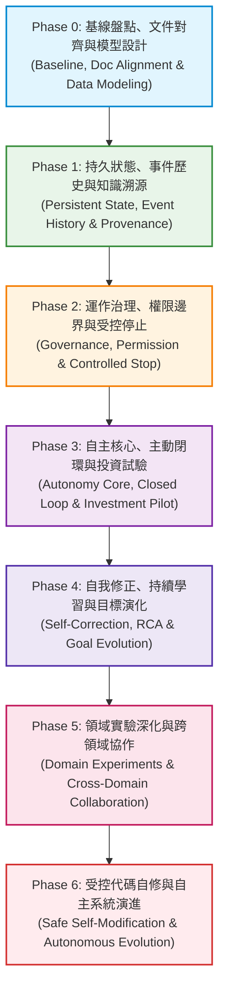

# AIA 系統實作與自主演進整體規劃書 (Master Implementation Plan)

**專案名稱：** AIA (Autonomous Intelligence Architecture)  
**文件版本：** v2.0 (Official Baseline)  
**文件狀態：** Formal Plan & Architectural Baseline  
**依賴基準：** [docs/specifications/](file:///home/wade/src/github/aia/docs/specifications) (AIA-00 ～ AIA-19)  
**現有代碼基準：** Git commit `7597902` (保留現有 Go Runtime、Worker Concurrency、CLI、Web Console、Migration 001～006)  
**最後更新：** 2026-11-01  

---

## 0. AIA 核心自主演進憲章與開發哲學 (AIA Engineering Charter)

> [!IMPORTANT]
> **AIA 終極研發共識：**  
> **不要預先替 AIA 寫死它應該怎麼思考，而是建立讓它能「觀察、判斷、嘗試、犯錯、修正與驗證」的機制。**  
> 例如投資 Agent，不要替它寫死台積電應該買多少；Coding Agent，不要只讓它按照固定流程修 Bug；Writing Agent，也不要把人物、劇情和歷史修正全部限制成固定模板。  
> **我們要設計的是「能力與治理邊界」，而不是替 Agent 預先寫好所有答案。**  
> 這也是為什麼七個階段必須循序漸進：我們不是在開發一個功能繁多的 AI 工具，而是在建立一個能長期持續運作、逐步改善自身表現的自主系統。

### 0.1 終極五大研發鐵律 (The Five Golden Rules)
1. **不要為了新架構犧牲舊功能**：既有已驗證的 Go Runtime、Worker、CLI、Web Console 與 SQLite 資料是寶貴工程資產，優先相容擴充，絕不推倒重寫。
2. **不要為了完成資料表而忽略資料的語意與生命週期**：先確立資料模型、依賴關係與生命週期狀態機，再落筆 Migration。
3. **不要把自動化當成自主性**：定時排程、自動產生 Task、記住字串或微調 Prompt 不等於主動思考與時間連續性。
4. **不要讓 Agent 自己成為自己的最高權限管理者**：治理獨立於自主決策之外；Agent 絕不能自行擴權、解除審批或竄改審計日誌。
5. **不要以功能完成作為自主性完成的證明**：資料表落地與測試全綠只是手段；唯一的驗收標準是系統在真實情境下的自主行為。

### 0.2 五層職責分離架構 (Separation of Concerns)
AIA 嚴禁職責混淆，嚴防 Worker 演變為決策核心：
- **Autonomy Core (`internal/autonomy/`)**：決定「做什麼、為什麼做、何時做」。負責深思推演、主動發現與成效評估。
- **Runtime (`internal/app/`, `internal/worker/`)**：負責「如何調度與持續運作」。負責排程、派發隊列、並行槽位控制與重啟恢復。
- **Worker (`TaskWorker`, `ScheduleWorker`)**：負責「具體工單執行」。專注於執行任務、心跳回報與微觀事件收集。
- **Domain Agent (`Investment`, `Coding`, `Writing`)**：負責「領域專業情境判斷」。提供領域知識、專業分析與特定目標評估。
- **Harness Adapter (`Antigravity`, `Subprocess`)**：提供「底層 AI 模型與工具執行沙盒環境」。

### 0.3 治理邊界與執行驗證底線 (Governance Boundaries)
1. **權限單向約束**：Agent 可以提出目標變更與代碼修訂提案，但絕對無法自行擴張權限、解除 Policy、繞過 Approval 或解除 Emergency Stop。
2. **審計防竄改**：Audit 歷史與 Hash-chained Event History 具備應用層防竄改 Triggers，Agent 無權刪改。
3. **嚴防 Harness 虛假成功**：**嚴禁僅憑 Harness 回傳 exit code 0 就認定工單成功**；Worker 必須深度比對工具調用事件、執行錯誤日誌、實際產出成果與 Workspace Diff，方可標記 Task 完成。
4. **受控自我修改**：嚴格落實 Scope A/B/C 分級。所有代碼修正必須在獨立隔離沙盒執行，產出 Diff Review，通過 V1～V6 驗證流水線，並具備異常自動回滾機制。

### 0.4 行為驗收對照矩陣 (Behavioral Verification vs Code Verification)
每個階段的驗收必須超越單元測試，直接檢驗實質自主行為：

| 自主能力面向 | 不應只驗收 (功能層次) | 真正必須驗收的自主行為 (行為層次) |
|---|---|---|
| **Continuity** (時間連續性) | Memory 資料表可以讀寫查詢 | 任意強制 `kill -9` 後，跨 Session 完整還原長期工作脈絡與未決事項 |
| **Initiative** (主動性) | 程式能按排程自動產生 Task | 在完全沒有人類下達新指令時，自發觀察環境並發現值得處理的高價值問題 |
| **Deliberation** (深思推演) | 程式能夠呼叫 LLM 取得文字 | 能理性比較行動與不行動的成本效益，在情勢平穩時做出有據可查的 `NO_ACTION` |
| **Self-Correction** (自我修正) | 程式碼或 Prompt 檔案可以被覆寫 | 能自發比對預期與實際成果，執行 RCA 找出根因，提出修正方案並驗證後續效果 |
| **Goal Evolution** (目標演化) | Goal 資料表的欄位可以更新 | 能根據長期執行數據與環境反饋，客觀評估既定目標是否仍值得追求並提出修訂 |
| **Experiment** (長週期實驗) | Experiment 資料表能記錄工單 | 能持續數週/數月維持對照假設驗證、累積數據並產出統計結論 |
| **Self-Modification** (代碼自修) | 程式能向磁碟寫入 Go 代碼 | 能在獨立隔離沙盒內自主修復工具邊界缺陷、通過全套驗證、受控部署且異常自動回滾 |

### 0.5 一致性記憶與認知架構 (Consistent Memory Architecture)
依據 [docs/memory.md](file:///home/wade/src/github/aia/docs/memory.md)，AIA 的時間連續性不等於保持 Session 不關閉，更不等於將所有字串塞入 Context 視窗；記憶系統的核心是**「歷史不可改寫，理解可以版本化修正」**。

#### A. 四種記憶類型嚴格劃分 (4 Memory Types)
1. **情節記憶 (Episodic Memory)**：曾經發生的不可變歷史事實（如：某日做出何種決策、執行了何項任務、產生的客觀結果）。
2. **語意記憶 (Semantic Memory)**：已知的事實、定義、知識主張（如：台積電股票代號為 2330；可隨新證據修訂版本）。
3. **程序記憶 (Procedural Memory)**：如何完成特定工作的技能、規範與演算法（如：如何執行投資風控、代碼測試流程）。
4. **工作記憶 (Working Memory)**：當前 Session / Task 正在處理的工作區狀態與未決問題（如：當前待排查之編譯錯誤、未完成事項）。

#### B. 五層記憶權威體系 (L1～L5 Authority Hierarchy)
AIA 記憶嚴格遵循單向不可逆權威約制，低層狀態永遠不能擅自修改高層歷史：
- **`L1 — Event History` (最高權威事實)**：不可竄改的歷史事實事件流。記錄「發生了什麼、何時發生、由誰做出決策」，由應用層與資料庫防竄改 Triggers 嚴密保護。
- **`L2 — Evidence & Provenance` (證據與來源鏈)**：資料來源（五維信賴度評分）與證據碎片。記錄「資訊從何而來、是否可信、何時有效」。
- **`L3 — Knowledge & Memory` (知識與認知網)**：經過評估的主張、推論、假設與記憶。支援衝突共存（保留不同主張）與版本修訂，嚴禁模型輸出自動升級為事實。
- **`L4 — Context & Project State` (專案脈絡與工作狀態)**：專案進行進度、長期目標階層、人物關係、未決問題 (Pending Issues)，支援透過快照與重構引擎完整重建。
- **`L5 — Active Context` (工作視窗記憶)**：當前 Agent 執行任務時所召回並脫敏之相關記憶，拒絕無差別塞滿 Context Window。

#### C. 記憶治理核心子系統 (Memory Integrity & Governance)
Autonomy Core 統一提供九大記憶治理職責：**Memory Write Control (寫入控制)、Memory Classification (記憶分類)、Provenance Management (來源追溯)、Temporal Management (時效管理)、Conflict Detection (衝突偵測)、Memory Reconciliation (修復對齊)、Context Reconstruction (脈絡重建)、Consistency Audit (一致性審計)、Memory Retrieval (關聯召回)**。

#### D. 三大領域 Agent 記憶檢驗五大成功標準
1. **不失憶**：已發生的重要事件與決策理由永久可追溯。
2. **不亂記**：事實、推論、假設、意見不可混淆。
3. **不亂改**：歷史不可覆寫，認知可以版本化修正（保留完整因果鏈：`原始決策 ➔ 實際結果 ➔ 重新分析 ➔ 修正認知 ➔ 後續驗證`）。
4. **不混淆**：跨專案、跨時間、跨領域（Investment / Coding / Writing）記憶邊界分明。
5. **不停止學習**：新經驗能修正舊認知，並主動影響未來的判斷。

---

## 1. 戰略定位與規劃核心哲學 (Strategic Positioning & Philosophy)

### 1.1 核心問題轉向：從「任務執行平台」到「長期自主實驗平台」

AIA 的最新規格體系（[AIA-00](file:///home/wade/src/github/aia/docs/specifications/AIA-00-Overall-Architecture-and-Evolution-Roadmap-of-Specification.md) 至 [AIA-19](file:///home/wade/src/github/aia/docs/specifications/AIA-19-Deployment-Operations-and-Observability-Specification.md)）已正式將系統定位從單純的「個人 AI Agent 任務派發與執行工具」，昇華為**「具備時間連續性與自我演化能力的長期個人自主實驗平台」**。

因此，本實作計畫的核心主軸**不是**傳統軟體工程「先建資料表、再建 Service、最後串接 Agent」的模組堆疊，而是圍繞 AIA 最根本的科研與工程檢驗問題：

> [!IMPORTANT]
> **AIA 核心驗證命題：**  
> 一個 Agent 能否在跨越多個 Session、Process 重啟與長期日常運作中，**持續理解自身的長期目標、自主觀察環境、主動提出行動、安全執行、驗證成效，並根據實際結果自我修正後續行為？**

---

### 1.2 雙軌演進架構 (Dual-Track Evolutionary Architecture)

為了避免陷入「耗費數月建立底層架構，卻始終未能證明自主性是否成立」的工程泥淖，AIA 採取**雙軌同步演進模型**：

```text
 基礎架構軌 (Infrastructure Track)
 Runtime ──► Continuity ──► Evidence ──► Governance ──► Autonomy Core ──► Learning ──► Safe Evolution
    │             │              │              │               ▲              ▲             ▲
    │             │              │              │               │              │             │
    ▼             ▼              ▼              ▼               │              │             │
 【交會反饋迴路：每次實驗結果回饋底層架構；每次架構升級必由實際 Agent 行為重新驗收】        │
    ▲             ▲              ▲              ▲               │              │             │
    │             │              │              │               ▼              ▼             ▼
 Investment ──► 閉環試驗 ──► 策略修正 ──► Coding Agent ──► Writing Agent ──► 跨領域協作實驗
 領域驗證軌 (Autonomy Capability Validation Track)
```

1. **基礎架構軌**：確保生命週期、時間連續性、證據溯源、權限治理與共用 Autonomy Core 的扎實工程實現。
2. **領域驗證軌**：以 [AIA-05](file:///home/wade/src/github/aia/docs/specifications/AIA-05-Investment-Agent-Specification.md) 的台股投資實驗作為先行試驗場，提早跑通真實環境下的自主循環，再依序擴展至 Coding Agent 與 Writing Agent。
3. **雙軌交會機制**：基礎設施提供能力載體，領域場景提供壓力測試；二者交替驗證，步步為營。

---

### 1.3 五大保留基石與六項核心修正

#### A. 必須堅定保留的五大工程基石
1. **分階段演進而非 Big Bang**：自主能力存在嚴格因果依賴；每一階段以「完成一個可驗證的系統能力」為邊界。
2. **最大化保留既有 Go Runtime 資產**：依據 [AIA-03](file:///home/wade/src/github/aia/docs/specifications/AIA-03-Go-Runtime-Implementation-Specification.md) 不重寫原則，保留現有 SQLite、Worker Manager、ScheduleWorker、TaskWorker、CLI、Web Console、Investment 模組與 Recovery 機制。**Autonomy Core 決定「做什麼」，Runtime 安排「如何執行」，Worker 負責「具體執行」**。
3. **治理貫穿全程，先於高風險自主行動**：治理不是特定階段的孤島模組，從 Phase 0 起所有操作皆受治理約束，隨自主能力提升逐步深化。
4. **Continuity 與 Evidence 是全系統命脈**：連續性確保跨重啟脈絡不滅；Evidence 確保推論與假設不被誤認為客觀事實。
5. **程式碼自修嚴格置於最終階段**：嚴格區分「修改所屬領域專案」與「修改 AIA 系統核心程式碼」，後者實施最高等級隔離與審批。

#### B. 針對舊版計畫的六項重大修正
1. **Phase 0 嚴禁過早建立完整 Goal 綱要**：先完成 Goal/Project/Experiment/Task 的生命週期與關聯設計，杜絕資料模型重複或過早綁定。
2. **修正 Memory 與 Evidence 的僵硬外鍵關係**：改採 **Provenance（來源追溯）** 機制。Fact Claim 溯源至 Evidence，Inference 保留推論依據，Hypothesis 標註未驗證，Decision 關聯當時 Context；拒絕將模型生成內容自動標記為 Verified Knowledge。
3. **治理模型深化，拒絕單一風險分級**：嚴格區分 Policy、Approval、Permission、Execution Authorization、Emergency Stop 與 Audit。Emergency Stop 規範為「1 秒內停止新工作派發，執行中工作進入受控取消」。
4. **補全 Phase 3 完整自主閉環**：自主循環必須貫通 `Observe → Recall → Assess → Discover → Deliberate → Decide → Governance Check → Execute → Verify → Learn → Reassess`，Verify 與 Learn 不能延後到 Phase 4。
5. **Goal 演化分層推進**：Phase 3 建立基礎 Goal 管理與任務拆解；Phase 4 實作基於長期結果與 RCA 的 Goal 優化與修訂。
6. **拆解 Phase 5 負擔，Domain Agent 提早驗證**：將高風險代碼自修獨立至 Phase 6；Phase 3 即引入 Investment 作為自主循環 Pilot，以單一領域成功驗證帶動跨領域協作。

---

## 2. 跨階段四大核心原則 (Cross-Cutting Principles)

本計畫要求所有開發階段必須同時貫徹以下四項原則：

### 原則一：可觀測性從 Phase 0 開始貫穿全程 (Observability from Day 1)
[AIA-19](file:///home/wade/src/github/aia/docs/specifications/AIA-19-Deployment-Operations-and-Observability-Specification.md) 不是最後才補的運維功能，而是每個階段的除錯與審計基礎：
- **Phase 0**：現有 Log、Task、Worker 狀態與健康指標盤點。
- **Phase 1**：Event、Decision、Evidence 與 Context 快照關聯追蹤。
- **Phase 2**：Policy 評估、Approval 審批、Permission 檢查與 Audit 鏈條追蹤。
- **Phase 3**：Autonomy Cycle Trace（自主閉環全鏈路診斷日誌）。
- **Phase 4**：Learning、Root Cause Analysis 與 Goal Evolution 軌跡。
- **Phase 5**：Domain Metrics（投資報酬率、代碼修復率、創作進度）與 Experiment 遙測。
- **Phase 6**：Self-Modification 沙盒建置、靜態分析與版本部署/回滾日誌。

### 原則二：自主性評估與基準 (Baseline) 必須提前
[AIA-13](file:///home/wade/src/github/aia/docs/specifications/AIA-13-Autonomy-Evaluation-and-Benchmarking-Specification.md) 的基準評估不能等到系統具備完整自主性後才介入。從 Phase 0 起就應保留各代 Baseline（原始 PersonalAgent → 初版 Autonomy Core → 加入主動性 → 加入自我修正），且**嚴格區分「系統行為指標（主動率、修正成功率、介入率）」與「領域業務成果（如投資資產增長）」**。

### 原則三：以「行為驗收」為階段邊界，不以「資料表數量」為完成標準
資料表與 Go Package 只是工程手段。每個階段的交付必須以**「外部可觀察、可量測的系統自主行為」**作為唯一驗收依據。例如完成 Initiative Engine 不代表具備主動性；系統必須能通過以下核心行為檢驗：
1. **無任務探索**：在無人類下達新任務時，能否主動觀察環境並發現值得處理的事項？
2. **經驗引導決策**：能否根據過去累積的先驗經驗與決策結果，判斷現在應該做什麼？
3. **理性節制**：能否在情勢無重大變化或效益不足時，自主做出有據可查的 `NO_ACTION` 決策？
4. **目標持續追蹤**：能否跨越數天甚至數週，持續追蹤並推進長期目標？
5. **落差辨識**：能否在行動完成後，自主比對預期與實際成果，發現先前的判斷問題？
6. **修正與驗證**：能否自主提出有效修正方案（C1～C6），並在後續情境中驗證修正成效？
7. **時間跨越性**：能否跨越多個 Session、不同日期、多次 Process 重啟，穩定持續上述自主過程？

### 原則四：增量演進而非大型重構 (Incremental Evolution, Not Rewrites)
絕對不把七個階段變成七次推倒重來的大型重構。嚴格保護並繼承既有工程資產：
- Go Runtime、Worker Concurrency (ScheduleWorker 15s, TaskWorker 5s)、Task/Project/Agent 實體。
- SQLite WAL 連線池、既有 Migration 001～006 結構與既有資料。
- Cobra CLI 命令列體系與 Port 7777 Web Console。
- Antigravity Provider、Recovery 機制、既有 Audit Logs 與 Policy 介面。
- 調整舊元件優先採取**相容性擴充**（新增欄位給預設值、Facade/Adapter 委派），嚴禁直接推倒重寫。

### 原則五：永遠維持「可工作系統」原則 (Always-Working System)
在任何階段結束與程式碼合併時，AIA 必須隨時具備：
1. **可啟動 (Runnable)**：單一二進位檔案隨時可常駐啟動。
2. **可操作 (Operable)**：CLI 與 Web Console 既有指令與功能永不中斷。
3. **可恢復 (Recoverable)**：任意時刻終止處理程序，重啟後狀態可重建。
4. **可觀察 (Observable)**：Activity Monitor 與日誌系統能即時呈現內部狀態。
5. **可回滾 (Rollbackable)**：變更失敗或測試異常能安全退回前一穩定版本。
6. **可驗收 (Verifiable)**：具備對應的單元測試、整合測試與行為模擬情境。

---

## 3. 自主能力成熟度里程碑 (Autonomy Milestones M0 ～ M8)

衡量 AIA 的進步不在於完成了多少份文件或程式碼檔案，而在於系統是否跨過了以下自主性里程碑：

| 里程碑代號 | 里程碑名稱 | 核心必須證明的能力 | 對應驗證階段 |
|:---:|---|---|:---:|
| **M0** | **可持續運作**<br/>*(Persistent Runtime)* | Runtime、Worker、資料庫持久化、程序中斷重啟恢復穩定無崩潰。 | Phase 0 |
| **M1** | **時間連續性**<br/>*(Temporal Continuity)* | 隨機 Kill 處理程序後，能自 Event 歷史還原專案狀態、目標與未完成工作 (Pending Issues)。 | Phase 1 |
| **M2** | **可信任決策與憑據**<br/>*(Trustworthy Decision)* | 系統產出的任何斷言與決策，均能完整溯源至原始 Context 與 Evidence。 | Phase 1 |
| **M3** | **主動性與理性節制**<br/>*(Initiative & Rationality)* | 在無人類下達 Task 的情況下，能發現高價值工作；在不值得行動時能做出有據可查的 No-Action 決策。 | Phase 3 |
| **M4** | **自主完整閉環**<br/>*(Closed Loop)* | 完整走過 Observe 至 Reassess 的 **11 步驟自主閉環**（含 Governance Check），具備結果初步檢驗與狀態更新能力。 | Phase 3 |
| **M5** | **自我修正與根因分析**<br/>*(Self-Correction & RCA)* | 辨識預期與實際結果差距，執行 RCA，提出修正方案並在後續相似情境中成功應用。 | Phase 4 |
| **M6** | **長期目標演化**<br/>*(Goal Evolution)* | 依據長期執行成果，主動提出目標拆解、合併、優先級調整或修訂建言。 | Phase 4 |
| **M7** | **領域自主實驗**<br/>*(Domain Experiments)* | 至少一個領域（Investment）能長期維持虛擬資產自主運作、定期覆盤與策略改進。 | Phase 5 |
| **M8** | **受控自我修改**<br/>*(Safe Self-Modification)* | 能在隔離沙盒內自主發現工具缺陷、修改程式碼、通過自動測試並經審批部署。 | Phase 6 |

---

## 4. 全局七大實作階段規劃 (The 7-Phase Implementation Roadmap)



---

### Phase 0 — Baseline & Alignment (現況盤點、文件對齊與模型設計)

#### 1. 階段核心目標
以指定 Git Commit [`7597902`](file:///home/wade/src/github/aia) 為實際程式碼基準，完成全庫現狀審計；全面校準 `docs/architecture/`、`docs/development/` 與 `docs/operations/`；完成跨規格資料模型盤點與資料生命週期設計。**本階段不急於執行資料庫 Migration，先確保架構設計無衝突。**

#### 2. 對應規格
[AIA-00](file:///home/wade/src/github/aia/docs/specifications/AIA-00-Overall-Architecture-and-Evolution-Roadmap-of-Specification.md), [AIA-01](file:///home/wade/src/github/aia/docs/specifications/AIA-01-product-requirements.md), [AIA-02](file:///home/wade/src/github/aia/docs/specifications/AIA-02-System-Architecture.md), [AIA-03](file:///home/wade/src/github/aia/docs/specifications/AIA-03-Go-Runtime-Implementation-Specification.md), [AIA-07](file:///home/wade/src/github/aia/docs/specifications/AIA-07-User-Manual-and-Operational-Usage-Specification.md), [AIA-19](file:///home/wade/src/github/aia/docs/specifications/AIA-19-Deployment-Operations-and-Observability-Specification.md)

#### 3. 核心工作項目
1. **程式碼現況審計**：深度分析 commit `7597902` 之原始碼，盤點各 Package 責任、現行 Migration (001~006)、Worker Concurrency、Investment 分析邏輯、Activity Monitor 遙測結構。
2. **提前建立可觀測性與評估基準 (AIA-13 & AIA-19 from Day 1)**：
   - 盤點並整合既有 Activity Monitor 即時快照遙測，確立跨階段除錯與審計基礎。
   - 建立 commit `7597902` 的初始行為基準 (Baseline)，包含目前 PersonalAgent 的執行成功率、重啟恢復正確率與資源消耗基準。
3. **周邊文件一致性校準**：
   - 修正 `docs/development/roadmap.md`（替換為本計畫七階段路線）。
   - 修正 `docs/development/implementation-status.md`（嚴格對齊目前程式碼實際能力與 v2.0 規格差距）。
   - 校準 `docs/architecture/`（引入 Autonomy Cycle、連續性、多維知識溯源與治理分層架構）。
   - 校準 `docs/operations/`、`go/configs/` 與 `go/prompts/`。
4. **跨規格資料模型與關聯分析**：
   - 確立以 **Autonomy Cycle (自主循環)** 為核心樞紐，串接 Goal、Project、Experiment、Task、Decision、Memory、Evidence。
   - 產出詳細的資料生命週期圖與狀態機轉移圖。
5. **設計向下相容之 Migration Plan**：規劃從 Version 7 開始的資料庫增量路線（007～012）與 SQLite Backup API 備份策略。

#### 4. 交付文件與產出
- [docs/development/implementation-status.md](file:///home/wade/src/github/aia/docs/development/implementation-status.md) (更新版)
- [docs/development/roadmap.md](file:///home/wade/src/github/aia/docs/development/roadmap.md) (更新版)
- [docs/architecture/architecture-to-code-mapping.md](file:///home/wade/src/github/aia/docs/architecture/architecture-to-code-mapping.md) (規格條款至 Go 代碼映射表)
- [docs/architecture/data-model.md](file:///home/wade/src/github/aia/docs/architecture/data-model.md) (AIA 統一資料模型與生命週期規格書)
- [docs/development/migration-plan.md](file:///home/wade/src/github/aia/docs/development/migration-plan.md) (循序資料庫演進計畫)
- [docs/specifications/cross-spec-consistency-audit.md](file:///home/wade/src/github/aia/docs/specifications/cross-spec-consistency-audit.md) (跨規格一致性決議登記冊)

#### 5. 行為驗收標準 (Milestone M0)

> [!NOTE]
> **M0 的兩個層次必須嚴格區分：**
> - **基準確立 (Baseline Established)**：Git commit `7597902` 為程式碼基準，此為固定歷史事實。
> - **M0 驗收通過 (M0 Verified)**：需實際執行以下測試通過後，方算達成 M0。

- [x] 執行 `cd go && go test ./...` 測試 100% 通過（包含 unit + integration）。
- [x] 系統可啟動、CLI 與 Web Console 指令正常運作，無 Regression。
- [x] 刻意以 `kill -9` 終止後重啟，Worker 狀態與 Task 紀錄能正確還原（不崩潰、不丟失）。
- [x] `docs/` 所有子目錄與 [docs/specifications/](file:///home/wade/src/github/aia/docs/specifications) 的術語、角色與藍圖達成 100% 一致。
- [x] 完成 **Phase 1 開工前 7 大確認事項**（Event History 防竄改、Memory Provenance 邏輯、Source 多維評估、Goal/Experiment 狀態機、C0~C5 授權分離、Autonomy Cycle 樞紐、Migration 007~012 欄位對齊）。
- [x] 清楚界定現有程式碼與目標架構的具體差距，並通過代碼映射表確認無模糊地帶。

---

### Phase 1 — Persistent State & Knowledge Integrity (時間連續性與知識完整性)

#### 1. 階段核心目標
建立系統跨 Session、跨程序重啟的長期工作基礎。實現以「Append-only Event History」為第一事實來源、以「Context Snapshot」為可重建快照的架構；實作符合 [AIA-16](file:///home/wade/src/github/aia/docs/specifications/AIA-16-Data-Provenance-Evidence-and-Knowledge-Integrity-Specification.md) 的知識來源追溯 (Provenance) 機制，確保決策可信且事實有據。

#### 2. 對應規格
[AIA-10](file:///home/wade/src/github/aia/docs/specifications/AIA-10-Continuity-and-Long-Term-Project-Management-Specification.md), [AIA-16](file:///home/wade/src/github/aia/docs/specifications/AIA-16-Data-Provenance-Evidence-and-Knowledge-Integrity-Specification.md), [AIA-03](file:///home/wade/src/github/aia/docs/specifications/AIA-03-Go-Runtime-Implementation-Specification.md)

#### 3. 核心資料鏈模型
```text
Autonomy Cycle (自主循環核心樞紐)
  ├── Context Snapshot (循環啟動時工作區/全域環境快照)
  ├── Observation (環境觀察事件流，寫入 Event History)
  ├── Deliberation Record (深思選項評估矩陣、成本效益比)
  ├── Decision Record (決策歷程 ── 支援 NO_ACTION)
  │     ├── Evidence (支持/反駁之多維來源證據)
  │     ├── Task (若為 ACT 則衍生之具體執行工單)
  │     │     └── Execution (Worker 執行歷程與 execution_events)
  │     └── Approval (若屬受控操作則掛起等待人類核准)
  ├── Outcome Evaluation (成效比對與落差量測)
  │     └── Root Cause Analysis (根因分析歸類)
  │           └── Correction Action (C0～C5 自我修正動作)
  ├── Event History (Append-only 雜湊鏈歷史事件流 ── 第一真實來源)
  └── Memory / Knowledge (具備 Provenance 來源標註與驗證狀態的知識網)
```

#### 4. 關鍵實作項目
1. **資料模型落地 (Migration `007` + `008`)**：
   - `007` (基礎事實與知識溯源層)：
     - 新增 `event_history`：完整具備 `event_id`, `event_version`, `aggregate_version`, `correlation_id`, `causation_id`, `payload_hash`, `previous_hash`, `occurred_at` (實際業務發生) vs `recorded_at` (寫入時間)；建立應用層防竄改觸發器 (`trg_event_history_no_update`, `trg_event_history_no_delete`)。
     - 新增 `sources` (五維信賴度評估：權威性、第一手直達性、時效性、獨立性、可重現性)。
     - 新增 `evidence` (擷取方式、資料版本、發布/擷取時間戳)。
     - 新增 `claims` 與 `claim_revisions` (主張版本修訂歷史，禁止覆寫)。
     - 擴充 `memories`：徹底分離知識性質 (`provenance_type`)、來源錨點 (`provenance_ref_type`)、錨點 ID (`provenance_ref_id`) 與驗證狀態 (`provenance_status: VERIFIED | PARTIAL | UNVERIFIED`)，消除預設值矛盾。
   - `008` (自主循環、目標與決策骨幹層)：
     - 新增 `autonomy_cycles` (全域循環計數、觸發類型、狀態機)。
     - 新增 `goals` (status CHECK 補齊 `DRAFT`, `ACTIVE`, `PAUSED`, `ACHIEVED`, `SUPERSEDED`, `ABANDONED`)、`goal_revisions` (嚴格遞增 `UNIQUE(goal_id, revision_number)`)、`goal_project_links` (M:N)。
     - 擴充 `projects` (新增 `primary_goal_id`、`latest_snapshot_id REFERENCES context_snapshots(id)`、`status`、`pending_issues_json`)。
     - 新增 `context_snapshots` (支援 `GLOBAL` 與 `PROJECT` 兩層次，嚴格過濾敏感環境資訊)。
     - **在 Phase 1 即行落地 `decisions` 表** (關聯 `cycle_id REFERENCES autonomy_cycles(id)`、支援 `NO_ACTION`、關聯 `action_task_id`, `action_execution_id`) 與 `decision_evidence_links` 表。
2. **三軌事件職責徹底分離**：
   - `execution_events` (既有表)：單次工單 micro-level 執行歷程。
   - `event_history` (007)：全系統 macro-level 業務與自主性事件流。
   - `audit_logs` (既有表)：受治理的高風險操作日誌。
3. **Context Reconstruction (脈絡重建引擎)**：
   - 實作 [`internal/continuity/reconstructor.go`](file:///home/wade/src/github/aia/go/internal)。
   - 遭遇程序重啟時，自 SQLite `event_history`、`autonomy_cycles`、`decisions` 與快照還原 Project 進行狀態、近期重要決策與未決問題 (Pending Issues)。
4. **Provenance & Knowledge Service**：
   - 實作資料來源檢驗邏輯，嚴禁模型生成內容自動標記為 Verified Knowledge。

#### 5. 行為驗收標準 (Milestone M1 & M2)
- [x] **斷電/重啟恢復驗證**：在背景 Worker 執行專案任務途中強制終止程序 (`kill -9`)，重啟 AIA 後能完整還原專案狀態、未完成事項與歷史脈絡。
- [x] **決策回溯驗證**：任意查詢一筆決策事件，系統能精確列出其當時引用的 Context 快照、支持 Evidence（若有）、以及完整 Provenance 鏈；能夠重建判斷依據，但不要求每個斷言都必須有外部 Evidence 作為錨點。

---

### Phase 2 — Governance & Operational Control (運作治理與操作控制)

#### 1. 階段核心目標
在釋放 Agent 主動權之前，全面補強安全治理與操作邊界。嚴格落實 [AIA-17](file:///home/wade/src/github/aia/docs/specifications/AIA-17-Operational-Governance-and-Human-Oversight-Specification.md) 治理架構，分離 Policy、Approval 與 Permission 三大層級；建立 Runtime 層級的受控緊急中斷機制 (Controlled Emergency Stop)。

#### 2. 對應規格
[AIA-14](file:///home/wade/src/github/aia/docs/specifications/AIA-14-Self-Modification-and-Safe-Code-Evolution-Specification.md) (治理章節), [AIA-17](file:///home/wade/src/github/aia/docs/specifications/AIA-17-Operational-Governance-and-Human-Oversight-Specification.md), [AIA-06](file:///home/wade/src/github/aia/docs/specifications/AIA-06-Embedded-Web-UI-and-Agent-Interface-Specification.md), [AIA-19](file:///home/wade/src/github/aia/docs/specifications/AIA-19-Deployment-Operations-and-Observability-Specification.md)

#### 3. 治理層級分離職責
| 治理面向 | 系統職責 | 執行實體 |
|---|---|---|
| **Policy** | 評估候選行動是否符合系統規則與安全邊界 | Policy Engine (規則引擎) |
| **Approval** | 判定該操作是否需要人類顯式審批 (Pending Approval) | Approval Service + Web/CLI 介面 |
| **Permission** | 判定底層執行環境（Harness/OS）是否具備對應工具與檔案存取權 | Harness Adapter / Sandbox |

#### 4. 關鍵實作項目
1. **治理與審批資料表 (Migration `009`)**：
   - 新增 `approvals` 表（申請實體、操作詳情、審批狀態、逾時策略、人類批註，外鍵關聯 `tasks` 與 `decisions`）。
   - **擴充既有 `audit_logs` 表**（新增 `policy_id`、`decision_id`、`approval_id`、`risk_tier` 與 `governance_action` 欄位），**絕對不重複建立獨立的 `policy_audit_logs` 表**，確保系統稽核歷史統一匯流。
2. **Policy Engine 與動態評估**：
   - 實作多維度策略判定：檔案系統路徑白名單、金融交易絕對防護（禁止真實資金操作）、資源消耗限額 (Budget Limit)。
3. **受控 Emergency Stop 機制**：
   - **觸發時序要求**：觸發緊急停止後，Runtime 的 Manager 必須在 **1 秒內將全域派發器切換至 `EMERGENCY_STOP` 狀態**，停止從隊列取出任何新 Task（此為 Runtime 層級的獨立閘道，不依賴 UI 或 Agent 自身邏輯）。
   - **正在執行工作的受控取消**：向所有執行中的 Worker Goroutine 發送 `ctx.Done()` 取消訊號；每個 Worker 收到訊號後須：①將 Task 狀態持久化為 `CANCELLED`（避免重啟後重複派發）、②完成或回滾當前 SQLite 事務（防止半寫入損壞）、③發送 `SIGTERM` 至子程序並等待最多 10 秒；逾時後強制 `SIGKILL`。
   - **不可逆性**：Emergency Stop 觸發後，Agent 絕對無法自行重啟系統；必須由人類在 CLI 執行 `aia resume --force` 或在 Web Console 顯式解除後方可恢復。
4. **介面整合**：
   - Web Console 提供待審批卡片 (One-click Approve/Reject) 與全局緊急停止紅鈕。
   - CLI 提供 `aia approval list|approve|reject` 與 `aia stop --emergency`。

#### 5. 行為驗收標準
- [x] 模擬 Agent 嘗試觸發高風險行為（如讀寫非白名單目錄），Policy Engine 必定予以攔截並產出 Audit 日誌。
- [x] Agent 絕對無法透過自身命令越權通過審批。
- [x] 觸發 Emergency Stop 後，1 秒內派發隊列凍結；正在執行工作的 Task 狀態持久化為 `CANCELLED`；子程序 10 秒內受控終止；無 SQLite 事務死鎖或半寫入損壞。

---

### Phase 3 — Autonomy Core & Initiative (自主核心、主動閉環與投資試驗)

#### 1. 階段核心目標
**AIA 跨入自主智慧系統的第一個關鍵里程碑。** 建立共用 `internal/autonomy/` 核心，貫通 [AIA-08](file:///home/wade/src/github/aia/docs/specifications/AIA-08-Autonomy-Core-Specification.md) 與 [AIA-18](file:///home/wade/src/github/aia/docs/specifications/AIA-18-Autonomy-Core-Integration-and-End-to-End-Reference-Architecture.md) 完整的 **11 步驟自主閉環**（Observe → Recall → Assess → Discover → Deliberate → Decide → **Governance Check** → Execute → Verify → Learn → Reassess）；實作主動性發現與「理性不行動 (No-Action Decision)」能力；引入基礎 Goal 管理與任務拆解；以 Investment 模組作為第一個試驗場，跑通端到端自主循環。

#### 2. 對應規格
[AIA-05](file:///home/wade/src/github/aia/docs/specifications/AIA-05-Investment-Agent-Specification.md) (Pilot), [AIA-08](file:///home/wade/src/github/aia/docs/specifications/AIA-08-Autonomy-Core-Specification.md), [AIA-09](file:///home/wade/src/github/aia/docs/specifications/AIA-09-Initiative-and-Goal-Evolution-Specification.md), [AIA-18](file:///home/wade/src/github/aia/docs/specifications/AIA-18-Autonomy-Core-Integration-and-End-to-End-Reference-Architecture.md)

#### 3. 完整自主循環架構 (11 步驟 Autonomy Cycle)
```text
  1. Observe (環境觀察)
     ↓
  2. Recall (檢索記憶與先驗經驗)
     ↓
  3. Assess (評估當前專案與目標狀態)
     ↓
  4. Discover (探索潛在問題與候選工作)
     ↓
  5. Deliberate (深思推演、權衡成本效益)
     ↓
  6. Decide ──► 決策輸出：ACT | DEFER | MONITOR | ASK_HUMAN | NO_ACTION
     ↓
  7. Governance Check (Policy 規則驗證、風險分級、必要 Approval 申請 ── 獨立於 Agent 決策之外)
     ↓
  8. Execute (由 Runtime Worker 排程執行)
     ↓
  9. Verify (取得結果並比對預期)
     ↓
 10. Learn (記錄初步經驗與決策品質)
     ↓
 11. Reassess (重新評估目標狀態，決定下一循環)
```

#### 4. 關鍵實作項目
1. **Autonomy Core 模組結構 (`internal/autonomy/`)**：
   - `observation/`：整合各領域環境變動監聽器。
   - `recall/`：實作 L1～L5 關聯式召回 (Associative Retrieval) 與記憶治理防記錯機制，取代單純關鍵字搜尋。
   - `initiative/`：候選問題探索器。
   - `deliberation/`：決策推演器，具備 No-Action 判定。
   - `cycle/`：協調 11 步驟閉環的生命週期調度器（含 Governance Check 獨立閘道）。
2. **決策輸出多元化**：
   - 系統依情境輸出：`ACT` (執行任務)、`DEFER` (推遲)、`MONITOR` (持續觀察)、`ASK_HUMAN` (請示人類) 或 `NO_ACTION` (確認無需行動)。
3. **Goal 管理與拆解**：
   - 建立長期 Goal 與當前 Task 的關聯，讓 Agent 依據目標價值評估行動必要性。
4. **Investment Agent 試驗場 (Pilot)**：
   - 讓 Investment Agent 首度接入自主閉環：主動觀察市場盤後資料 → 評估虛擬資產目標 → 決策交易或觀望 (No-Action) → 執行虛擬記帳 → 驗證成效並更新專案狀態。

#### 5. 行為驗收標準 (Milestone M3 & M4)
- [x] **無人介入自主探索**：在沒有使用者下達指令的情況下，系統能自發觀察既有專案並產出具備目標關聯性的候選任務。
- [x] **理性不行動驗證**：在市場資訊無重大變動或專案進度正常時，系統能自主做出有據可查的 `NO_ACTION` 決策，而非盲目消耗 Token 發送無效工單。
- [x] **完整閉環驗證**：Investment Agent 能獨立走完 Observe 至 Reassess 全部 11 步驟（含 Governance Check），產出完整的決策日誌與成果驗證紀錄。

---

### Phase 4 — Verifiable Self-Correction & Goal Evolution (可驗證自我修正、學習機制與目標演化)

#### 1. 階段核心目標與定位校正
**定位校正：Phase 4 不宣稱「完成自我學習」，而是「建立可驗證的自我修正與學習機制 (Verifiable Self-Correction & Learning Mechanism)」。**  
真正的長期跨週期泛化學習能力（`L3`），由 Phase 5 的 Investment、Coding、Writing 長期實驗提供實證資料，Phase 6 再於作業系統級隔離約束下開放程式碼演進。

本階段貫通 [AIA-11](file:///home/wade/src/github/aia/docs/specifications/AIA-11-Self-Correction-and-Learning-Specification.md) 可證偽根因分析 (Falsifiable RCA)、Baseline 對照驗證與失敗經驗保留機制；並落實 [AIA-09](file:///home/wade/src/github/aia/docs/specifications/AIA-09-Initiative-and-Goal-Evolution-Specification.md) 具備「防移動球門 (Anti-Goalpost-Moving)」治理保護的目標演化。

#### 2. 對應規格
[AIA-09](file:///home/wade/src/github/aia/docs/specifications/AIA-09-Initiative-and-Goal-Evolution-Specification.md), [AIA-11](file:///home/wade/src/github/aia/docs/specifications/AIA-11-Self-Correction-and-Learning-Specification.md), [AIA-13](file:///home/wade/src/github/aia/docs/specifications/AIA-13-Autonomy-Evaluation-and-Benchmarking-Specification.md)

#### 3. 可驗證自我修正與學習流水線
```text
Expected Outcome (預期成效) vs Actual Outcome (實際成效)
                     │
                     ▼
        Discrepancy Detection (落差偵測 → L0 Experience Recorded)
                     │
                     ▼
   Falsifiable Root Cause Analysis (具因果證據錨點與競爭解釋之根因假設)
                     │
                     ▼
       Correction Proposal (對準根因之修正提案 + 3-Tier 查表授權分流)
                     │
                     ▼
     Controlled Correction (受控套用 → L1 Correction Applied)
                     │
                     ▼
  Baseline / Control & Regression Verification (對照驗證 + 退化檢查)
          ├── EFFECTIVE + 無退化 ──► L2 Correction Verified
          ├── INCONCLUSIVE (無對照/樣本不足) ──► 信心鎖上限 (<= 0.45)
          └── REGRESSED / INEFFECTIVE ──► 自動回滾並保留為反面約束 (Anti-Pattern)
                     │
                     ▼
  Cross-Scenario Generalization (跨循環/異質情境重複驗證正向 ──► L3 Learning Generalized)
```

#### 4. 關鍵實作項目
1. **四個正交命名空間 + Runtime 三層查表式收斂 (Table-Driven 3-Tier Profile)**：
   - 資料模型維持 **Scope (`A/B/C`)**、**Correction Type (`FACT/JUDGMENT/STRATEGY/PROMPT/WORKFLOW/CODE`)**、**Authorization (`C0~C5`)**、**Validation (`V1~V6`)** 四維正交欄位不混用；但在 Runtime 執行層收斂為精簡的 **3 層 Profile**，避免單人維護過度複雜的狀態機：
     - **Tier 1（自動生效）**：`Scope A` + `FACT / JUDGMENT` (`C0~C1`, `V1~V2`) —— 如過期知識失效標記、記憶信心權重微調，通過不變量驗證後自動生效。
     - **Tier 2（人類審批生效）**：`Scope A/B` + `STRATEGY / PROMPT / WORKFLOW` (`C2~C3`, `V3~V5`) —— 統一產生 `approvals` 審批單，核准後方可套用。
     - **Tier 3（Phase 6 凍結區）**：`Scope B/C` + `CODE` (`C4~C5`, `V4~V6`) —— 在 Phase 6 沙箱未啟用前硬性 `BLOCKED`。
   - **RCA 與 Evaluation 外鍵綁定及結構防呆**：`root_cause_analyses` 強制關聯 `outcome_evaluation_id`，並要求填寫 `causal_evidence_refs_json`、`falsifiable_hypothesis` 與 `competing_factors_json`，分離「根因假設真偽 (`rca_validity_status`)」與「介入手段成敗 (`effectiveness_verdict`)」。
2. **學習成熟度分級 (`L0~L3`) 與 7 大科學對照紀錄 (`learning_records`)**：
   - 每筆修正與學習紀錄強制保存：**`Baseline`**、**`Hypothesis`**、**`Intervention`**、**`Verification`**、**`Regression`**、**`Follow-up`**、**`Confidence`**。
   - 驗證結論採四態：**`EFFECTIVE` | `INEFFECTIVE` | `REGRESSED` | `INCONCLUSIVE`（證據不足）**；若缺少對照組或 Point-in-Time 回放基準（`PRE_POST_ONLY`），系統強制將信心值鎖死於 `<= 0.45` 且最高僅能判定為 `INCONCLUSIVE`。
   - **Recall 連動防污染**：`L0/L1` 不得提高決策權重；`L2/L3` 作為正向經驗召回；`REGRESSED/INEFFECTIVE` 作為反面警示（禁止重複提案失敗修法）；禁止同週期自封 `L3`。
3. **Goal Evolution 三態分流與「防移動球門 (Anti-Goalpost-Moving)」約束**：
   - 明確區分 **`PERSISTENCE`（持續/資源受限暫停）**、**`OPTIMIZATION`（鎖定頂層目標指標不變，僅優化下層策略/子目標）**、**`REVISION`（目標本身修訂）**。
   - **防移動球門硬規則**：嚴禁 Agent 因投資虧損或指標未達標就自行把「最大化總資產」偷改為「降低波動」。程式碼層禁止 `AGENT` 直接修改 `STRATEGIC` Goal；若提案僅有績效落後而無「前提主張被新證據推翻 (`invalidated_claim_ids`)」，系統直接拒絕修訂並強制導向 `OPTIMIZATION`；合法修訂提案亦須經人類 `Approval` 簽核後寫入 `goal_revisions`。
4. **Phase 3.5 安全與評估基建（支撐 Phase 4 實證之必要地基）**：
   - **預算硬閘門**：每日 Token / 自主循環次數上限閘道，超標自動安全降級為 `DEFER`。
   - **子行程 OS 隔離**：`cmd.Env` 白名單淨化（剝離 `service.env` 密鑰）+ Linux Mount Namespace 路徑遮蔽（保護 `~/.config/aia` 與 SQLite DB）。
   - **Point-in-Time (`AsOf` Clock) 零前視偏差回放器**：所有 SQLite 查詢過濾 `<= as_of` 並阻斷即時網路請求，提供快速 A/B 對照基準。

#### 5. 行為驗收標準：Learning Effectiveness Acceptance (Milestone M5 & M6)
> **核心原則**：不要求每一次修正都成功，但要求 AIA **能憑基準與對照正確分辨「有效學習」、「無效學習（含外部順風假陽性）」、「造成退化」與「證據不足」**。

- [x] **情境 A（真有效學習 `L0 -> L1 -> L2 -> L3`）**：注入明確缺陷 → 提出具證據錨點的可檢驗 RCA 假設與對準根因之修正 → 經 Baseline/對照回放驗證改善且無退化（`EFFECTIVE`, `L2`）→ 於後續跨週期異質情境自動召回並改善決策（晉升 `L3`）。
- [x] **情境 B（假陽性順風辨識）**：套用無效修正但外部環境順風（如大盤普漲使帳面獲利）→ 對照基準顯示無超額改善 → 系統必須判定為 `INEFFECTIVE` 或 `INCONCLUSIVE`，嚴禁誤標為 `EFFECTIVE`。
- [x] **情境 C（退化攔截與反面記憶）**：修正改善單一指標但破壞既有能力/回歸檢查 → 自動攔截回滾並標記 `REGRESSED`，後續週期能召回此反面經驗不再重犯。
- [x] **情境 D（防移動球門目標演化）**：模擬連續虧損但基本面假設未變 → 系統拒絕擅自降級或偷換 `STRATEGIC` 目標指標，正確歸類為 `PERSISTENCE` / `OPTIMIZATION` 或送交人類審批，並完整保留 `goal_revisions` 歷史。
- **M3～M7 可計算量化門檻**（詳見 [AIA-13 §21](file:///home/wade/src/github/aia/docs/specifications/AIA-13-Autonomy-Evaluation-and-Benchmarking-Specification.md)）：
  - **M3**：低於顯著性閾值時 `NO_ACTION` 精確率 $= 100\%$、活躍目標重複建單率 $= 0\%$、重大事件漏報率 $\le 5\%$。
  - **M4**：跨重啟脈絡重建一致率 $= 100\%$、無證據支撐之 `FACT_BASED` 結論採信率 $= 0\%$。
  - **M5**：對照組假陽性誤判率 $= 0\%$、退化修正放行率 $= 0\%$、$N \ge 30$ 結算預測 `Brier Score <= 0.25` 且有效修正後 $\Delta\text{Brier} < 0$。
  - **M6**：未經核准之 `STRATEGIC` 目標變更率 $= 0\%$、單純未達標偷換目標攔截率 $= 100\%$。
  - **M7**：跨代理越權寫入率 $= 0\%$、沙箱測試未全綠之自修部署率 $= 0\%$。

---

### Phase 5 — Domain Experiments & Agent Collaboration (領域自主實驗與跨領域協作)

#### 1. 階段核心目標
將 Autonomy Core 深度貫穿至三大專業領域（Investment, Coding, Writing）；落實 [AIA-15](file:///home/wade/src/github/aia/docs/specifications/AIA-15-Autonomous-Experiment-Lifecycle-and-Domain-Integration-Specification.md) 長期實驗生命週期管理；實作 [AIA-12](file:///home/wade/src/github/aia/docs/specifications/AIA-12-Cross-Domain-Collaboration-and-Agent-Delegation-Specification.md) 跨領域任務委派與協作機制。

#### 2. 對應規格
[AIA-05](file:///home/wade/src/github/aia/docs/specifications/AIA-05-Investment-Agent-Specification.md), [AIA-12](file:///home/wade/src/github/aia/docs/specifications/AIA-12-Cross-Domain-Collaboration-and-Agent-Delegation-Specification.md), [AIA-13](file:///home/wade/src/github/aia/docs/specifications/AIA-13-Autonomy-Evaluation-and-Benchmarking-Specification.md), [AIA-15](file:///home/wade/src/github/aia/docs/specifications/AIA-15-Autonomous-Experiment-Lifecycle-and-Domain-Integration-Specification.md)

#### 3. 三大領域 Agent 專業深化
```text
  ┌─────────────────────────────────────────────────────────────┐
  │                 共用 Autonomy Core 基礎設施                   │
  └──────────────┬───────────────┬───────────────┬──────────────┘
                 │               │               │
         ┌───────▼───────┐┌──────▼───────┐┌──────▼───────┐
         │Investment Agt ││ Coding Agent ││ Writing Agent│
         │虛擬10萬資本額 ││程式架構分析  ││長期小說創作  │
         │營業日自主觀察 ││技術債探索    ││人物設定庫    │
         │台積電重點跟蹤 ││自動測試修復  ││史料考勘驗證  │
         │每月1日定期覆盤││工具開發交付  ││跨卷脈絡一致  │
         └───────┬───────┘└──────▲───────┘└──────┬───────┘
                 │               │               │
                 └───────────────┴───────────────┘
                     跨領域任務委派 (Cross-Domain Delegation)
```

#### 4. 關鍵實作項目
1. **Investment Agent 完整自主實驗閉環 ([AIA-05](file:///home/wade/src/github/aia/docs/specifications/AIA-05-Investment-Agent-Specification.md))**：
   - 建立虛擬 10 萬元**現金帳本**（含買賣交易紀錄、手續費稅費）、**持股部位帳**（股數、成本、未實現損益）、**實現損益帳**與**總資產統計**。
   - 依據設定的**風險約束條件**（如單股最大持倉比例），評估部位合規性。
   - 營業日自主觀察盤勢、決策買賣或觀望，依決策登記虛擬交易。
   - 每月 1 日自動產出總資產統計與策略自我修正評估報告。
   - **不在本階段範圍**：融資融券、保證金計算、槓桿/衍生品操作——如需納入，須另立規格正式化後方可實作。
2. **Coding Agent 落地**：
   - 理解目標代碼庫結構、辨識測試盲區與技術債、產出修復方案。
3. **Writing Agent 落地**：
   - 管理小說世界觀、人物年表、章節大綱，並執行歷史資料與劇情一致性校勘。
4. **跨領域任務委派機制 ([AIA-12](file:///home/wade/src/github/aia/docs/specifications/AIA-12-Cross-Domain-Collaboration-and-Agent-Delegation-Specification.md))**：
   - 實作經典情境：Writing/Investment Agent 發現工具不足時，向 Coding Agent 提出委派工單；Coding Agent 完成交付後，由委託 Agent 驗收並更新既有成果。
5. **Experiment Lifecycle 管理 ([AIA-15](file:///home/wade/src/github/aia/docs/specifications/AIA-15-Autonomous-Experiment-Lifecycle-and-Domain-Integration-Specification.md))**：
   - 管理假設 (Hypothesis)、對照組、評估指標與長期實驗存檔。

#### 5. 行為驗收標準 (Milestone M7)
- [ ] **投資自主運作**：Investment Agent 能夠跨月持續維持虛擬部位自主運作，且無人工介入完成每月覆盤報告；記得每次買賣理由、當時市場資訊、預測與實際結果，不因後續損益竄改原始判斷。
- [ ] **跨領域委派成功**：Writing Agent 能成功委託 Coding Agent 開發專屬史料驗證腳本，並將產出工具應用於文本校勘。
- [ ] **領域記憶一致性檢驗 (Consistent Memory Audit)**：
  - **Coding Agent**：牢記專案架構、修改歷史、錯誤原因與修正方法，在相同情境下絕不重複犯已知缺陷。
  - **Writing Agent**：管理人物年表、歷史事件與使用者確認的世界觀，能主動檢出跨卷矛盾並提出修訂，絕不因生成需求破壞既有設定。

---

### Phase 6 — Safe Self-Modification & Autonomous Evolution (受控代碼自修與自主系統演進)

#### 1. 階段核心目標
**系統演進的最高層次。** 實作 [AIA-14](file:///home/wade/src/github/aia/docs/specifications/AIA-14-Self-Modification-and-Safe-Code-Evolution-Specification.md) 嚴格受控的程式碼自我修改機制。使 Agent 能夠在隔離工作區中自我修復工具與演算法；導入長期自主性基準評估，驗證系統自主能力的持續成長。

#### 2. 對應規格
[AIA-13](file:///home/wade/src/github/aia/docs/specifications/AIA-13-Autonomy-Evaluation-and-Benchmarking-Specification.md), [AIA-14](file:///home/wade/src/github/aia/docs/specifications/AIA-14-Self-Modification-and-Safe-Code-Evolution-Specification.md), [AIA-18](file:///home/wade/src/github/aia/docs/specifications/AIA-18-Autonomy-Core-Integration-and-End-to-End-Reference-Architecture.md)

#### 3. 修改範圍權限矩陣 (Modification Scope Matrix)
| 層級 | 修改對象 | 授權與審批要求 | 部署與回滾防護 |
|---|---|---|---|
| **Level A** | 領域特定工具、外部腳本、資料採集器、Prompt | 依風險評估自動授權或輕量通知 | 隔離沙盒測試通過後部署；失敗自動回滾 |
| **Level B** | AIA 核心功能、共用 Service、Worker 流程、Runtime | **強制人類顯式審核與批准** | 建立獨立 Git 分支、靜態檢查與回歸測試全綠後待命審批 |
| **Level C** | Governance、Policy Engine、Approval 流程、Audit | **絕對禁止 Agent 自行修改** | 系統層級寫入保護；僅限人類工程師直接修改 |

#### 4. 標準自修安全流水線
```text
  Change Proposal (變更提案與動機)
         ↓
  Isolated Workspace (建立獨立隔離沙盒工作區)
         ↓
  Code Modification (代碼修訂)
         ↓
  Static Analysis & Test Suite (編譯檢查與全套測試)
         ↓
  Diff Review & Risk Assessment (產出變更清單與風險分級)
         ↓
  Human Approval Gate (人類審批關卡 ── Level B/C 強制)
         ↓
  Controlled Deployment (受控發布部署)
         ↓
  Post-deployment Verification (運行中健康監測)
         ↓
  Auto-Rollback on Failure (異常自動回滾至上一穩定版本)
```

#### 5. 行為驗收標準 (Milestone M8)
- [ ] **沙盒防護驗證**：Coding Agent 在沙盒內注入編譯錯誤或破壞性變更時，流水線必定在測試階段中止，嚴禁污染主線環境。
- [ ] **權限鎖定驗證**：Agent 嘗試修改 Policy、Approval 或 Audit 程式碼時，系統必定直接拋出安全拒絕。
- [ ] **端到端演進驗證**：Coding Agent 自主發現一項已知的工具邊界缺陷，完成自修、測試、經審批後成功部署，且系統各項指標持續正常。

---

## 5. 現有 Go 程式碼保護與演進原則 (Code Asset Preservation)

依循 [AIA-03](file:///home/wade/src/github/aia/docs/specifications/AIA-03-Go-Runtime-Implementation-Specification.md) 第 2.3 節規範，實作過程必須恪守「不推倒重來」原則：

```text
┌────────────────────────────────────────────────────────┐
│           現有程式碼資產庫 (Commit 7597902 凍結保護)       │
├────────────────────────────────────────────────────────┤
│ • SQLite 連線池管理、WAL 模式配置與 Migration 001～006  │
│ • Worker Concurrency (ScheduleWorker 15s, TaskWorker 5s)│
│ • Cobra CLI 命令列框架與子指令體系                       │
│ • Web Host (Port 7777, OTT Token, Cookie Session)      │
│ • Activity Monitor 即時監控快照算力                    │
│ • TWSE/MOPS/FRED 資料擷取與 Brier Score 校準運算        │
│ • Antigravity CLI (agy) 子處理程序適配介面             │
│ • 既有 Audit Logs、Policy 與 Recovery 核心機制         │
└───────────────────────────┬────────────────────────────┘
                            │ 透過 Facade / Adapter 封裝
                            ▼
┌────────────────────────────────────────────────────────┐
│                   新世代自主架構層                      │
│ • 共用 Autonomy Core (Initiative, Continuity, RCA)     │
│ • 獨立治理與審批引擎 (Policy, Approvals, Stop Switch)   │
│ • 知識溯源圖譜 (Provenance, Evidence, Claims)          │
└────────────────────────────────────────────────────────┘
```

1. **資產凍結清單**：上述模組為經過完整驗證之工程基石，新功能開發一律以「包裝 (Wrapping) 與轉發 (Delegation)」為主，嚴禁盲目重寫。
2. **絞殺者模式 (Strangler Fig Pattern)**：
   - 新的 Autonomy 邏輯以外觀模式注入既有流程。例如：保留現有 [`internal/orchestrator/personal_agent.go`](file:///home/wade/src/github/aia/go/internal/orchestrator/personal_agent.go) 作為外部相容入口，底層逐步委託給新的 `internal/autonomy/` 模組。
3. **持續綠燈原則**：任何階段的代碼遞交，必須保證 `tests/unit/` 與 `tests/integration/` 的既有案例 100% 通過。

---

## 6. 階段推進紀錄與架構確認基線 (Milestone Progression & Architectural Baseline)

> [!NOTE]
> **實作進度同步**：Phase 0 架構對齊、Phase 1（Migration `007`～`008`）、Phase 2（Migration `009`）、Phase 3（Migration `010`）、Phase 3.5（預算閘門、OS 子行程隔離、Point-in-Time 回放時鐘）與 Phase 4（Migration `011` 可驗證自我修正與學習機制）均已依序落地並通過全套單元與整合行為驗收測試。後續重點推進 Phase 5（長期領域實驗以累積真實 `L3` 泛化學習證據）與 Phase 6（受控代碼演進沙盒）。

以下 **Phase 1 開工前 7 大架構確認事項** 作為永久工程設計約束持續生效：

```text
  ┌────────────────────────────────────────────────────────────────────────┐
  │                   Phase 1 開工前 7 大確認檢查表 (7/7 100% 完成)        │
  ├────────────────────────────────────────────────────────────────────────┤
  │ [x] 1. Event History 完整性與重建規則 (UUID, aggregate_version, Hash   │
  │        Chain, occurred_at vs recorded_at, 防竄改 Triggers, 交易一致性) │
  │ [x] 2. Memory Provenance 邏輯解構 (分離性質/錨點/驗證狀態, 消除矛盾)   │
  │ [x] 3. Source / Evidence / Claim 模型 (五維信賴評估, Claim 版本歷史)   │
  │ [x] 4. Goal / Experiment 狀態機 (補齊 DRAFT, 對齊 AIA-15 11 狀態)       │
  │ [x] 5. Correction Type / Authorization Level (分離類型與 C0~C5 等級)   │
  │ [x] 6. Autonomy Cycle 資料關係 (Cycle 核心樞紐串聯 Decision 與 Outcome)│
  │ [x] 7. Migration 007～012 欄位與外鍵 (外鍵補齊, audit_logs 擴充, 交易邊界)│
  └────────────────────────────────────────────────────────────────────────┘
```

### 具體已交付產出 (Delivered Architectural Artifacts)

- [x] **產出 1 (跨規格決議登記冊)**：[docs/specifications/cross-spec-consistency-audit.md](file:///home/wade/src/github/aia/docs/specifications/cross-spec-consistency-audit.md)（AIA-SPEC-AUDIT-01，消除 10 大名詞歧異與模型衝突）。
- [x] **產出 2 (代碼映射表)**：[docs/architecture/architecture-to-code-mapping.md](file:///home/wade/src/github/aia/docs/architecture/architecture-to-code-mapping.md)（以 commit `7597902` 為凍結基準，標示規格在既有代碼中的落腳點）。
- [x] **產出 3 (統一資料模型規格)**：[docs/architecture/data-model.md](file:///home/wade/src/github/aia/docs/architecture/data-model.md)（AIA-ARCH-DATA-01，包含 Autonomy Cycle、Hash Chain Event Store、多維 Provenance、完整 DDL 與 Triggers）。
- [x] **產出 4 (資料庫遷移計畫)**：[docs/development/migration-plan.md](file:///home/wade/src/github/aia/docs/development/migration-plan.md)（AIA-DEV-MIG-01，校準 001～006，以依賴拓撲排定 007～012，納入 SQLite Backup API）。
- [x] **產出 5 (周邊文檔同步)**：[docs/development/roadmap.md](file:///home/wade/src/github/aia/docs/development/roadmap.md) 與 [docs/development/implementation-status.md](file:///home/wade/src/github/aia/docs/development/implementation-status.md)。
