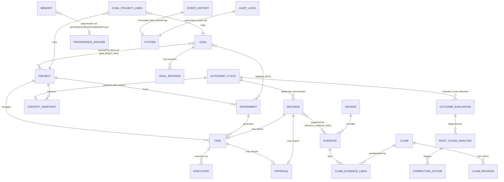

# AIA 統一資料模型與生命週期規格書 (Unified Data Model & Lifecycle Specification)

**文件代號：** AIA-ARCH-DATA-01  
**適用架構：** AIA v2.0 系列規範 (以 [AIA-SPEC-AUDIT-01](file:///home/wade/src/github/aia/docs/specifications/cross-spec-consistency-audit.md) 為基準)  
**底層儲存：** SQLite (WAL 模式)  
**現有代碼基準：** Git commit `7597902` (已內建 Migration Version 1 ～ 6)  
**文件狀態：** Normative Architectural Baseline  
**最後更新：** 2026-11-01  

---

## 1. 資料模型核心設計哲學 (Data Architecture Philosophy)

依據 [AIA-08](file:///home/wade/src/github/aia/docs/specifications/AIA-08-Autonomy-Core-Specification.md)、[AIA-10](file:///home/wade/src/github/aia/docs/specifications/AIA-10-Continuity-and-Long-Term-Project-Management-Specification.md)、[AIA-15](file:///home/wade/src/github/aia/docs/specifications/AIA-15-Autonomous-Experiment-Lifecycle-and-Domain-Integration-Specification.md)、[AIA-16](file:///home/wade/src/github/aia/docs/specifications/AIA-16-Data-Provenance-Evidence-and-Knowledge-Integrity-Specification.md) 與 [AIA-18](file:///home/wade/src/github/aia/docs/specifications/AIA-18-Autonomy-Core-Integration-and-End-to-End-Reference-Architecture.md)，AIA 採用「雙層狀態持久化模型」，並以「自主循環 (Autonomy Cycle)」為核心樞紐：

```text
 ┌────────────────────────────────────────────────────────────────────────┐
 │ 1. 歷史事實層 (Append-only Event History - 第一真實來源)                │
 │    記錄所有客觀發生的業務與自主性事件，具備 Hash Chain 與 Trigger 防竄改。│
 └───────────────────────────────────┬────────────────────────────────────┘
                                     │
                                     ▼ 透過 Context Reconstruction 還原
 ┌────────────────────────────────────────────────────────────────────────┐
 │ 2. 當前狀態層 (Reconstructible State Snapshots)                        │
 │    由 Autonomy Cycle 串接 Goal, Project, Experiment, Decision, Task,   │
 │    Evidence, Claim 與 Memory，即使狀態快照毀損亦可自 Event 流完整重建。  │
 └────────────────────────────────────────────────────────────────────────┘
```

---

## 2. 實體關係圖 (Entity-Relationship Diagram)



---

## 3. 核心實體結構與生命週期定義 (Core Entities)

### 3.0 不可竄改事件存儲 (Event History & Hash Chain)

作為時間連續性 (Continuity) 的第一事實來源，`event_history` 記錄所有宏觀業務與自主性事件。

```sql
CREATE TABLE event_history (
    id INTEGER PRIMARY KEY AUTOINCREMENT,
    event_id TEXT NOT NULL UNIQUE,          -- 全域唯一事件 UUID / ULID
    event_type TEXT NOT NULL,               -- GOAL_REVISED, CYCLE_STARTED, DECISION_COMMITTED...
    event_version INTEGER NOT NULL DEFAULT 1,-- 事件 Payload Schema 版本
    aggregate_type TEXT NOT NULL,           -- GOAL, PROJECT, EXPERIMENT, CYCLE, DECISION, GOVERNANCE
    aggregate_id TEXT NOT NULL,             -- 聚合根實體 ID
    aggregate_version INTEGER NOT NULL,     -- 該聚合根內嚴格遞增之事件序號 (1, 2, 3...)
    correlation_id TEXT NOT NULL,           -- 關聯整個自主循環或端到端工作流之 Trace ID
    causation_id TEXT NOT NULL,             -- 引發本事件之直接父事件 ID (首事件則為自身)
    actor_id TEXT NOT NULL,                 -- AGENT:xxx, USER, SYSTEM
    payload_json TEXT NOT NULL,             -- 事件本體 JSON
    payload_hash TEXT NOT NULL,             -- SHA256(payload_json) 內容完整性驗證
    previous_hash TEXT NOT NULL,            -- 指向前一筆記錄之 Hash，構成防竄改 Hash Chain
    occurred_at TIMESTAMP NOT NULL,         -- 業務實際發生時間點
    recorded_at TIMESTAMP NOT NULL DEFAULT CURRENT_TIMESTAMP, -- 系統資料庫持久化時間點
    UNIQUE(aggregate_type, aggregate_id, aggregate_version)
);

CREATE INDEX idx_event_history_aggregate ON event_history(aggregate_type, aggregate_id);
CREATE INDEX idx_event_history_correlation ON event_history(correlation_id);
CREATE INDEX idx_event_history_recorded ON event_history(recorded_at);
```

#### 不可竄改性與防竄改邊界規範
1. **SQLite 應用層防竄改觸發器 (Triggers)**：
   ```sql
   CREATE TRIGGER trg_event_history_no_update
   BEFORE UPDATE ON event_history
   BEGIN
       SELECT RAISE(ABORT, 'SECURITY ERROR: event_history is immutable and cannot be updated.');
   END;

   CREATE TRIGGER trg_event_history_no_delete
   BEFORE DELETE ON event_history
   BEGIN
       SELECT RAISE(ABORT, 'SECURITY ERROR: event_history is immutable and cannot be deleted.');
   END;
   ```
2. **防竄改邊界宣告**：
   > [!IMPORTANT]
   > 觸發器 (Trigger) 與雜湊鏈 (Hash Chain) 提供**應用層的防竄改保證與事後竄改偵測能力**。若攻擊者直接取得本機 SQLite 資料庫檔案之作業系統讀寫權限，理論上仍可藉由重算雜湊重構檔案。因此，AIA 規範本機檔案存取權限由作業系統 ACL (G0 治理) 與定時備份簽章共同防護。
3. **交易一致性要求**：
   業務狀態更新（如 Goal 狀態變更、Decision 寫入）與對應的 `event_history` 寫入，**必須包裹在同一 `BEGIN IMMEDIATE TRANSACTION` 交易內**，確保狀態與事件絕對一致。

---

### 3.1 目標實體 (Goal & GoalRevision)

Goal 描述系統或使用者希望達成的長期狀態。

```sql
CREATE TABLE goals (
    id TEXT PRIMARY KEY,
    parent_goal_id TEXT,                    -- 支援層級樹 (NULL 為頂層目標)
    name TEXT NOT NULL,
    description TEXT NOT NULL,
    level TEXT NOT NULL CHECK (level IN ('STRATEGIC', 'TACTICAL', 'OPERATIONAL')),
    status TEXT NOT NULL CHECK (status IN ('DRAFT', 'ACTIVE', 'PAUSED', 'ACHIEVED', 'SUPERSEDED', 'ABANDONED')),
    target_metric_json TEXT,                -- 目標達成度量標的 (如 {"total_asset": 150000})
    current_metric_json TEXT,               -- 當前度量進展
    priority INTEGER NOT NULL DEFAULT 5 CHECK (priority BETWEEN 1 AND 10),
    created_at TIMESTAMP NOT NULL,
    updated_at TIMESTAMP NOT NULL,
    FOREIGN KEY (parent_goal_id) REFERENCES goals(id)
);

CREATE TABLE goal_revisions (
    id TEXT PRIMARY KEY,
    goal_id TEXT NOT NULL,
    revision_number INTEGER NOT NULL,       -- 嚴格遞增版本號 (1, 2, 3...)
    previous_state_json TEXT NOT NULL,
    new_state_json TEXT NOT NULL,
    reason TEXT NOT NULL,                   -- 修訂理由
    decision_id TEXT,                       -- 關聯之決策 ID
    created_at TIMESTAMP NOT NULL,
    UNIQUE(goal_id, revision_number),
    FOREIGN KEY (goal_id) REFERENCES goals(id)
);

CREATE INDEX idx_goals_status ON goals(status);
```

#### Goal 狀態機規則 (AIA-09)
$$\text{DRAFT} \longrightarrow \text{ACTIVE} \longleftrightarrow \text{PAUSED} \longrightarrow \begin{cases} \text{ACHIEVED} \\ \text{SUPERSEDED} \\ \text{ABANDONED} \end{cases}$$

- **重啟規則**：`PAUSED` 狀態之目標允許隨時恢復為 `ACTIVE`。
- **終態規則**：`SUPERSEDED` 與 `ABANDONED` 為終態，不可再直接恢復為 `ACTIVE`；若欲追求類似目標，須建立新 Goal 並在 revision 記錄傳承關係。
- **防止循環**：Goal Service 於建立/更新 `parent_goal_id` 時，必須在記憶體中走訪父節點鏈，**嚴禁形成循環參照**。
- **版本強制性**：每次 Goal 的狀態變更、指標調整或描述修改，必須原子性寫入 `goal_revisions` 並記錄一筆 `GOAL_REVISED` 至 `event_history`。

---

### 3.1b Goal ↔ Project 多對多關聯表 (goal_project_links)

```sql
CREATE TABLE goal_project_links (
    goal_id    TEXT NOT NULL REFERENCES goals(id),
    project_id TEXT NOT NULL REFERENCES projects(id),
    link_type  TEXT NOT NULL DEFAULT 'CONTRIBUTES_TO' CHECK (link_type IN ('CONTRIBUTES_TO', 'VALIDATES', 'DERIVED_FROM')),
    created_at TIMESTAMP NOT NULL,
    PRIMARY KEY (goal_id, project_id)
);
```

---

### 3.2 專案與快照實體 (Project & Context Snapshot)

Project 是長期工作成果與工作區的實體載體。

```sql
-- 擴充現有 projects 表 (相容於 001)
ALTER TABLE projects ADD COLUMN status TEXT DEFAULT 'ACTIVE' CHECK (status IN ('ACTIVE', 'ARCHIVED', 'SUSPENDED'));
ALTER TABLE projects ADD COLUMN primary_goal_id TEXT REFERENCES goals(id);
ALTER TABLE projects ADD COLUMN latest_snapshot_id TEXT REFERENCES context_snapshots(id);
ALTER TABLE projects ADD COLUMN pending_issues_json TEXT DEFAULT '[]';

CREATE TABLE context_snapshots (
    id TEXT PRIMARY KEY,
    scope TEXT NOT NULL CHECK (scope IN ('GLOBAL', 'PROJECT')), -- 快照層級
    project_id TEXT,                        -- 若為 PROJECT 則必填
    snapshot_type TEXT NOT NULL CHECK (snapshot_type IN ('MANUAL', 'PRE_RESTART', 'POST_CYCLE', 'EMERGENCY_STOP')),
    workspace_state_json TEXT NOT NULL,     -- 安全工作區摘要 (僅限檔案列表、Git HEAD、Hash，嚴禁敏感資料)
    active_tasks_json TEXT NOT NULL,        -- 當時未完成的 Task ID 列表
    recent_decisions_json TEXT NOT NULL,    -- 最近關鍵 Decision ID 列表
    pending_issues_json TEXT NOT NULL,      -- 未決問題
    created_at TIMESTAMP NOT NULL,
    FOREIGN KEY (project_id) REFERENCES projects(id)
);
```

> [!CAUTION]
> **環境變數與敏感資訊過濾規範**：
> `workspace_state_json` 僅記錄檔案名稱、大小、Git Commit SHA 與安全配置；**嚴格禁止**序列化任何包含 API Key、Secret、Cookie、Token 或密碼的環境變數或檔案內容。

---

### 3.3 實驗實體 (Experiment - AIA-15 完整生命週期)

Experiment 用於驗證具備不確定性的策略、演算法或長週期科研假設。

```sql
CREATE TABLE experiments (
    id TEXT PRIMARY KEY,
    project_id TEXT NOT NULL,
    primary_goal_id TEXT NOT NULL,          -- 主要服務之目標
    name TEXT NOT NULL,
    hypothesis TEXT NOT NULL,               -- 實驗核心假設
    experiment_type TEXT NOT NULL CHECK (experiment_type IN ('CAPABILITY', 'STRATEGY', 'SYSTEM', 'CROSS_DOMAIN')),
    status TEXT NOT NULL CHECK (status IN (
        'PROPOSED',         -- 提案中
        'PENDING_APPROVAL', -- 等待人類審批
        'READY',            -- 準備就緒
        'RUNNING',          -- 執行中
        'PAUSED',           -- 暫停觀察
        'EVALUATING',       -- 評估指標中
        'NEEDS_REVISION',   -- 需要調整參數/假設
        'COMPLETED',        -- 成功完成驗證
        'STOPPED',          -- 受控中止
        'FAILED',           -- 實驗失敗/假設不成立
        'ARCHIVED'          -- 歸檔
    )),
    baseline_metrics_json TEXT NOT NULL,    -- 基準線度量標的
    current_metrics_json TEXT,              -- 實驗組度量最新數據
    iteration_count INTEGER DEFAULT 0,
    created_at TIMESTAMP NOT NULL,
    concluded_at TIMESTAMP,
    FOREIGN KEY (project_id) REFERENCES projects(id),
    FOREIGN KEY (primary_goal_id) REFERENCES goals(id)
);

CREATE TABLE experiment_goal_links (
    experiment_id TEXT NOT NULL REFERENCES experiments(id),
    goal_id       TEXT NOT NULL REFERENCES goals(id),
    created_at    TIMESTAMP NOT NULL,
    PRIMARY KEY (experiment_id, goal_id)
);

CREATE INDEX idx_experiments_status ON experiments(status);
```

---

### 3.4 自主循環實體 (Autonomy Cycle - 核心樞紐)

Autonomy Cycle 是 AIA 自主性的核心時間軸樞紐，貫通所有自發行為：

```sql
CREATE TABLE autonomy_cycles (
    id TEXT PRIMARY KEY,
    cycle_number INTEGER NOT NULL,          -- 嚴格遞增之全域循環計數
    trigger_type TEXT NOT NULL CHECK (trigger_type IN ('SCHEDULED', 'EVENT_TRIGGERED', 'MANUAL', 'DRIFT_DETECTED')),
    trigger_ref_id TEXT,                    -- 觸發來源 ID (如 schedule_id 或 event_id)
    status TEXT NOT NULL CHECK (status IN ('STARTED', 'DELIBERATING', 'EXECUTING', 'EVALUATING', 'COMPLETED', 'ABORTED')),
    context_snapshot_id TEXT REFERENCES context_snapshots(id),
    summary TEXT,                           -- 本循環總結
    started_at TIMESTAMP NOT NULL,
    completed_at TIMESTAMP,
    created_at TIMESTAMP NOT NULL
);

CREATE INDEX idx_cycles_status ON autonomy_cycles(status);
CREATE INDEX idx_cycles_started ON autonomy_cycles(started_at);
```

#### Cycle 解答的自主性 9 大核心問題
```text
autonomy_cycles
    ├── 1. 為什麼開始？ (trigger_type, trigger_ref_id)
    ├── 2. 當時看到了什麼？ (透過 event_history 記錄之 OBSERVATION 事件)
    ├── 3. 回憶了哪些過去資訊？ (context_snapshot_id, memories 檢索日誌)
    ├── 4. 發現哪些值得處理的問題？ (candidate_initiatives)
    ├── 5. 評估過哪些選項？ (deliberation_records)
    ├── 6. 最後為什麼採取或不採取行動？ (decisions: ACT | NO_ACTION 等)
    ├── 7. 執行結果如何？ (關聯之 tasks, executions)
    ├── 8. 有沒有學到什麼？ (outcome_evaluations, root_cause_analyses)
    └── 9. 下一次應該重新檢查什麼？ (寫入 pending_issues 與下一循環 trigger)
```

---

### 3.5 決策歷程與推演實體 (Decision & Deliberation Record)

每一次深思決策的客觀紀錄，**在 Phase 1 (Migration 008) 即行落地**，確保全系統決策有據可循。

```sql
CREATE TABLE decisions (
    id TEXT PRIMARY KEY,
    cycle_id TEXT REFERENCES autonomy_cycles(id), -- 關聯所屬自主循環
    project_id TEXT REFERENCES projects(id),
    experiment_id TEXT REFERENCES experiments(id),
    action_type TEXT NOT NULL CHECK (action_type IN ('ACT', 'DEFER', 'MONITOR', 'ASK_HUMAN', 'NO_ACTION')),
    intent_summary TEXT NOT NULL,           -- 決策意圖摘要
    justification TEXT NOT NULL,            -- 決策理由與深思推演依據
    considered_alternatives_json TEXT,      -- 評估過但捨棄的替代方案與捨棄原因
    context_snapshot_id TEXT REFERENCES context_snapshots(id), -- 當時環境快照
    governance_result TEXT NOT NULL CHECK (governance_result IN ('ALLOWED', 'REQUIRED_APPROVAL', 'BLOCKED')),
    action_task_id TEXT REFERENCES tasks(id),                 -- 若 ACT 則關聯具體工單
    action_execution_id TEXT REFERENCES executions(id),       -- 執行記錄
    created_at TIMESTAMP NOT NULL
);

CREATE TABLE decision_evidence_links (
    decision_id TEXT NOT NULL,
    evidence_id TEXT NOT NULL,
    relevance_note TEXT,
    PRIMARY KEY (decision_id, evidence_id),
    FOREIGN KEY (decision_id) REFERENCES decisions(id),
    FOREIGN KEY (evidence_id) REFERENCES evidence(id)
);

CREATE TABLE deliberation_records (
    id TEXT PRIMARY KEY,
    cycle_id TEXT NOT NULL REFERENCES autonomy_cycles(id),
    decision_id TEXT REFERENCES decisions(id), -- 決策定案後關聯
    candidate_initiative_id TEXT,              -- 關聯候選提案
    options_evaluated_json TEXT NOT NULL,      -- 各選項評估分數矩陣
    cost_benefit_analysis TEXT NOT NULL,       -- 成本效益比推演
    risk_assessment TEXT NOT NULL,             -- 風險評估
    created_at TIMESTAMP NOT NULL
);

CREATE INDEX idx_decisions_cycle ON decisions(cycle_id);
CREATE INDEX idx_decisions_action ON decisions(action_type);
```

---

### 3.6 通用知識溯源鏈與記憶模型 (Source, Evidence, Claim & Memory)

#### A. 多維來源評估 (Source Multi-Dimensional Reliability)
來源評估絕不簡化為單一數字，拆分為五項獨立維度：

```sql
CREATE TABLE sources (
    id TEXT PRIMARY KEY,
    source_type TEXT NOT NULL CHECK (source_type IN ('PRIMARY', 'OFFICIAL', 'SECONDARY', 'NEWS', 'ACADEMIC', 'COMMUNITY', 'MODEL', 'TOOL')),
    uri TEXT NOT NULL,                      -- 來源 URL 或檔案路徑
    publisher TEXT,
    authority_score REAL NOT NULL DEFAULT 0.5 CHECK (authority_score BETWEEN 0.0 AND 1.0),      -- 權威性 (官方/學術 vs 匿名)
    directness_score REAL NOT NULL DEFAULT 0.5 CHECK (directness_score BETWEEN 0.0 AND 1.0),    -- 第一手直達性 (一手資料 vs 轉載)
    timeliness_score REAL NOT NULL DEFAULT 0.5 CHECK (timeliness_score BETWEEN 0.0 AND 1.0),    -- 時效性
    independence_score REAL NOT NULL DEFAULT 0.5 CHECK (independence_score BETWEEN 0.0 AND 1.0),-- 獨立性 (利益無關 vs 業配公關)
    reproducibility_score REAL NOT NULL DEFAULT 0.5 CHECK (reproducibility_score BETWEEN 0.0 AND 1.0), -- 可重現性
    metadata_json TEXT DEFAULT '{}',
    created_at TIMESTAMP NOT NULL
);

CREATE TABLE evidence (
    id TEXT PRIMARY KEY,
    source_id TEXT NOT NULL REFERENCES sources(id),
    content_snippet TEXT NOT NULL,          -- 原始內容摘錄
    content_hash TEXT NOT NULL,             -- SHA256 避免重複抓取
    capture_method TEXT NOT NULL CHECK (capture_method IN ('HTTP_GET', 'HTML_PARSED', 'API_JSON', 'PDF_OCR', 'TOOL_STDOUT')),
    data_version TEXT DEFAULT '1.0',        -- 外部資料版本號
    published_at TIMESTAMP,                 -- 來源原始發布時間
    captured_at TIMESTAMP NOT NULL,         -- 系統擷取時間
    valid_until TIMESTAMP,                  -- 時間有效性期限 (NULL 表示無特定期限)
    created_at TIMESTAMP NOT NULL
);

CREATE TABLE claims (
    id TEXT PRIMARY KEY,
    statement TEXT NOT NULL,                -- 具體命題陳述
    assertion_status TEXT NOT NULL CHECK (assertion_status IN ('ACCEPTED', 'REJECTED', 'UNCERTAIN', 'CONFLICTED', 'SUPERSEDED')),
    is_knowledge INTEGER DEFAULT 0 CHECK (is_knowledge IN (0, 1)), -- 1 = 已晉升為跨 Agent 可信知識; 0 = 暫時主張
    current_version INTEGER NOT NULL DEFAULT 1,
    created_at TIMESTAMP NOT NULL,
    updated_at TIMESTAMP NOT NULL
);

CREATE TABLE claim_revisions (
    id TEXT PRIMARY KEY,
    claim_id TEXT NOT NULL REFERENCES claims(id),
    revision_number INTEGER NOT NULL,
    previous_statement TEXT NOT NULL,
    new_statement TEXT NOT NULL,
    reason TEXT NOT NULL,                   -- 修訂理由
    revised_decision_id TEXT REFERENCES decisions(id),
    created_at TIMESTAMP NOT NULL,
    UNIQUE(claim_id, revision_number)
);

CREATE TABLE claim_evidence_links (
    claim_id TEXT NOT NULL REFERENCES claims(id),
    evidence_id TEXT NOT NULL REFERENCES evidence(id),
    support_type TEXT NOT NULL CHECK (support_type IN ('SUPPORTS', 'REFUTES', 'QUALIFIES')),
    confidence_weight REAL DEFAULT 1.0,
    PRIMARY KEY (claim_id, evidence_id)
);
```

#### B. 記憶表架構調整 (Memories 表擴充與 Provenance 解構)
徹底分離「知識性質」與「來源錨點類型」，新增明確驗證狀態：

```sql
-- 擴充現有 memories 表 (100% 向下相容)
ALTER TABLE memories ADD COLUMN provenance_type TEXT DEFAULT 'INFERENCE' 
    CHECK (provenance_type IN ('FACT_BASED', 'INFERENCE', 'HYPOTHESIS', 'USER_PREFERENCE', 'AGENT_DECISION'));
ALTER TABLE memories ADD COLUMN provenance_ref_type TEXT DEFAULT 'NONE'
    CHECK (provenance_ref_type IN ('EVIDENCE', 'SOURCE', 'MEMORY', 'CONTEXT_SNAPSHOT', 'DECISION', 'NONE'));
ALTER TABLE memories ADD COLUMN provenance_ref_id TEXT;
ALTER TABLE memories ADD COLUMN provenance_status TEXT DEFAULT 'UNVERIFIED'
    CHECK (provenance_status IN ('VERIFIED', 'PARTIAL', 'UNVERIFIED'));
```

#### Provenance 完整性邏輯矩陣
| provenance_type (性質) | 允許之 provenance_ref_type | provenance_status 規範 | 說明 |
|---|---|---|---|
| `FACT_BASED` | `EVIDENCE` 或 `SOURCE` | 若缺少 ref 則必須為 `UNVERIFIED`；具備有效 Evidence 經查驗後方可晉升 `VERIFIED` | 客觀事實依據 |
| `INFERENCE` | `MEMORY` 或 `DECISION` 或 `NONE` | 預設為 `PARTIAL` 或 `UNVERIFIED`；推論鏈完整者標記 `VERIFIED` | 根據先驗記憶推導 |
| `HYPOTHESIS` | `NONE` 或 `DECISION` | **絕對禁止**標記為 `VERIFIED`（只能是 `UNVERIFIED`） | 待驗證假設 |
| `USER_PREFERENCE` | `SOURCE` 或 `NONE` | 使用者顯式宣告為 `VERIFIED` | 使用者偏好與設定 |
| `AGENT_DECISION` | `DECISION` | 關聯至具體 `decision_id` 為 `VERIFIED` | Agent 自身過往決策 |

---

### 3.7 治理與審批實體 (Approval & Audit)

```sql
CREATE TABLE approvals (
    id TEXT PRIMARY KEY,
    task_id TEXT REFERENCES tasks(id),
    decision_id TEXT REFERENCES decisions(id),
    operation_type TEXT NOT NULL CHECK (operation_type IN ('CODE_MODIFICATION', 'SYSTEM_CONFIG', 'LARGE_EXPENSE', 'DOMAIN_TRADE')),
    risk_tier TEXT NOT NULL CHECK (risk_tier IN ('LOW', 'MEDIUM', 'HIGH', 'CRITICAL')),
    requested_by_agent_id TEXT NOT NULL,
    status TEXT NOT NULL CHECK (status IN ('PENDING', 'APPROVED', 'REJECTED', 'EXPIRED', 'CANCELLED')),
    human_comment TEXT,
    requested_at TIMESTAMP NOT NULL,
    responded_at TIMESTAMP,
    expires_at TIMESTAMP NOT NULL,
    CHECK (task_id IS NOT NULL OR decision_id IS NOT NULL) -- 至少需關聯一項實體
);

-- 擴充既有 audit_logs 表 (不重複建表)
ALTER TABLE audit_logs ADD COLUMN policy_id TEXT DEFAULT '';
ALTER TABLE audit_logs ADD COLUMN decision_id TEXT DEFAULT '';
ALTER TABLE audit_logs ADD COLUMN approval_id TEXT DEFAULT '';
ALTER TABLE audit_logs ADD COLUMN risk_tier TEXT DEFAULT 'LOW';
ALTER TABLE audit_logs ADD COLUMN governance_action TEXT DEFAULT '';
CREATE INDEX IF NOT EXISTS idx_audit_decision ON audit_logs(decision_id);
CREATE INDEX IF NOT EXISTS idx_audit_approval ON audit_logs(approval_id);
```

---

### 3.8 成效評估、根因分析與自我修正 (Learning, RCA & Correction)

徹底分離**修改範圍 (`Scope A/B/C`)**、**修正類型 (`Correction Type`)**、**授權等級 (`C0~C5`)** 與**驗證深度 (`V1~V6`)**，並強制納入可證偽假設、Baseline 對照、退化檢查與 `L0~L3` 學習成熟度分級：

```sql
-- 補充執行層 Token 消耗統計欄位（供每日預算硬閘門即時聚合）
ALTER TABLE executions ADD COLUMN input_tokens INTEGER NOT NULL DEFAULT 0;
ALTER TABLE executions ADD COLUMN output_tokens INTEGER NOT NULL DEFAULT 0;
ALTER TABLE executions ADD COLUMN total_tokens INTEGER NOT NULL DEFAULT 0;

CREATE TABLE outcome_evaluations (
    id TEXT PRIMARY KEY,
    cycle_id TEXT REFERENCES autonomy_cycles(id),
    decision_id TEXT REFERENCES decisions(id),
    task_id TEXT REFERENCES tasks(id),
    project_id TEXT REFERENCES projects(id),
    domain TEXT NOT NULL DEFAULT 'general',
    expected_outcome_json TEXT NOT NULL,    -- 決策時設定之預期成果
    actual_outcome_json TEXT NOT NULL,      -- 實際觀測成果
    discrepancy_score REAL NOT NULL,        -- 落差量化指標 (0.0 表示無落差)
    is_anomaly INTEGER DEFAULT 0 CHECK (is_anomaly IN (0, 1)),
    evaluation_status TEXT NOT NULL CHECK (evaluation_status IN ('EVALUATED', 'NEEDS_RCA', 'RESOLVED')),
    evaluated_at TIMESTAMP NOT NULL
);

CREATE TABLE root_cause_analyses (
    id TEXT PRIMARY KEY,
    outcome_evaluation_id TEXT NOT NULL REFERENCES outcome_evaluations(id),
    root_cause_category TEXT NOT NULL CHECK (root_cause_category IN ('INCORRECT_FACT', 'BIASED_JUDGMENT', 'FLAWED_STRATEGY', 'AMBIGUOUS_PROMPT', 'WORKFLOW_DEFECT', 'EXTERNAL_UNEXPECTED')),
    analysis_narrative TEXT NOT NULL,               -- 根因分析說明
    falsifiable_hypothesis TEXT NOT NULL,           -- 可檢驗假設（若此根因為真，修正後應觀測到何種可證偽結果）
    causal_evidence_refs_json TEXT NOT NULL,        -- 因果證據錨點 ID 清單（禁止無證據事後編故事）
    competing_factors_json TEXT NOT NULL DEFAULT '[]', -- 外部順風/偶然因素等競爭解釋
    rca_validity_status TEXT NOT NULL DEFAULT 'PROPOSED' CHECK (rca_validity_status IN ('PROPOSED', 'SUPPORTED', 'FALSIFIED', 'INTERVENTION_MISMATCH', 'UNCERTAIN')),
    confidence REAL NOT NULL CHECK (confidence BETWEEN 0.0 AND 1.0),
    created_at TIMESTAMP NOT NULL
);

CREATE TABLE correction_actions (
    id TEXT PRIMARY KEY,
    rca_id TEXT NOT NULL REFERENCES root_cause_analyses(id),
    scope_level TEXT NOT NULL DEFAULT 'A' CHECK (scope_level IN ('A', 'B', 'C')),
    correction_type TEXT NOT NULL CHECK (correction_type IN ('FACT', 'JUDGMENT', 'STRATEGY', 'PROMPT', 'WORKFLOW', 'CODE')),
    authorization_level TEXT NOT NULL CHECK (authorization_level IN ('C0', 'C1', 'C2', 'C3', 'C4', 'C5')),
    validation_level TEXT NOT NULL DEFAULT 'V2' CHECK (validation_level IN ('V1', 'V2', 'V3', 'V4', 'V5', 'V6')),
    tier_profile TEXT NOT NULL DEFAULT 'TIER1_AUTO' CHECK (tier_profile IN ('TIER1_AUTO', 'TIER2_APPROVAL', 'TIER3_BLOCKED')),
    target_entity_ref TEXT NOT NULL,        -- 欲修正之目標參照 (如 claim:001 或 strategy:inv-materiality)
    before_state_json TEXT NOT NULL,        -- 修正前狀態（供退化時自動回滾）
    proposed_state_json TEXT NOT NULL,      -- 提案修正狀態
    applied_state_json TEXT,                -- 實際套用狀態
    approval_id TEXT REFERENCES approvals(id), -- 若屬 Tier 2 則強制關聯人類審批
    regression_status TEXT NOT NULL DEFAULT 'PENDING' CHECK (regression_status IN ('PENDING', 'PASSED', 'FAILED')),
    verification_status TEXT NOT NULL CHECK (verification_status IN ('PENDING', 'APPLIED', 'VERIFIED_EFFECTIVE', 'VERIFIED_INEFFECTIVE', 'INCONCLUSIVE', 'REGRESSED', 'ROLLED_BACK', 'BLOCKED')),
    created_at TIMESTAMP NOT NULL,
    updated_at TIMESTAMP NOT NULL
);

CREATE TABLE learning_records (
    id TEXT PRIMARY KEY,
    project_id TEXT REFERENCES projects(id),
    domain TEXT NOT NULL DEFAULT 'general',
    source_cycle_id TEXT REFERENCES autonomy_cycles(id),
    outcome_evaluation_id TEXT NOT NULL REFERENCES outcome_evaluations(id),
    rca_id TEXT REFERENCES root_cause_analyses(id),
    correction_action_id TEXT REFERENCES correction_actions(id),
    title TEXT NOT NULL,
    learning_level TEXT NOT NULL CHECK (learning_level IN ('L0_RECORDED', 'L1_APPLIED', 'L2_VERIFIED', 'L3_GENERALIZED')),
    effectiveness_verdict TEXT NOT NULL CHECK (effectiveness_verdict IN ('PENDING', 'EFFECTIVE', 'INEFFECTIVE', 'REGRESSED', 'INCONCLUSIVE')),
    comparison_method TEXT NOT NULL CHECK (comparison_method IN ('CONTROL_BENCHMARK', 'PIT_REPLAY', 'SIMILAR_COHORT', 'PRE_POST_ONLY')),
    baseline_json TEXT NOT NULL,            -- 1. 修正前表現基準
    hypothesis_json TEXT NOT NULL,          -- 2. 預期修正改善假設
    intervention_json TEXT NOT NULL,        -- 3. 實際採取之修正
    verification_json TEXT NOT NULL DEFAULT '{}', -- 4. 對照驗證結果（含超額改善幅度與樣本數）
    regression_json TEXT NOT NULL DEFAULT '{}',   -- 5. 是否造成其他能力退化
    followup_json TEXT NOT NULL DEFAULT '{}',     -- 6. 後續跨情境追蹤表現
    epistemic_confidence REAL NOT NULL CHECK (epistemic_confidence BETWEEN 0.0 AND 1.0), -- 7. 認識論信心（PRE_POST_ONLY 硬鎖 <= 0.45）
    generalized_cycle_ids_json TEXT NOT NULL DEFAULT '[]', -- 跨情境獨立驗證通過之 Cycle IDs（L3 硬門檻）
    created_at TIMESTAMP NOT NULL,
    updated_at TIMESTAMP NOT NULL
);

CREATE TABLE goal_evolution_proposals (
    id TEXT PRIMARY KEY,
    goal_id TEXT NOT NULL REFERENCES goals(id),
    cycle_id TEXT REFERENCES autonomy_cycles(id),
    evolution_mode TEXT NOT NULL CHECK (evolution_mode IN ('PERSISTENCE', 'OPTIMIZATION', 'REVISION')),
    actor_type TEXT NOT NULL,
    actor_id TEXT NOT NULL,
    rationale TEXT NOT NULL,
    previous_target_metric_json TEXT NOT NULL DEFAULT '{}',
    proposed_target_metric_json TEXT NOT NULL DEFAULT '{}',
    invalidated_claim_ids_json TEXT NOT NULL DEFAULT '[]', -- 修訂頂層目標必填之前提失效證據鏈
    resource_constraint_note TEXT NOT NULL DEFAULT '',
    status TEXT NOT NULL CHECK (status IN ('APPLIED', 'PENDING_APPROVAL', 'APPROVED', 'REJECTED_GOALPOST_MOVING', 'REJECTED')),
    approval_id TEXT REFERENCES approvals(id),
    resulting_revision_id TEXT REFERENCES goal_revisions(id),
    created_at TIMESTAMP NOT NULL,
    updated_at TIMESTAMP NOT NULL
);

CREATE INDEX idx_eval_discrepancy ON outcome_evaluations(discrepancy_score);
CREATE INDEX idx_corrections_rca ON correction_actions(rca_id);
CREATE INDEX idx_learning_level_domain ON learning_records(domain, learning_level, effectiveness_verdict);
CREATE INDEX idx_goal_evolution_goal ON goal_evolution_proposals(goal_id, status);
```

---

### 3.9 長期跨世代對照實驗與跨領域協作 (Generational Experiments & Delegation — Migration 012)

```sql
CREATE TABLE experiments (
    id TEXT PRIMARY KEY,
    project_id TEXT REFERENCES projects(id),
    primary_goal_id TEXT REFERENCES goals(id),
    domain TEXT NOT NULL DEFAULT 'investment',
    owner_agent_id TEXT NOT NULL DEFAULT 'investment-agent',
    name TEXT NOT NULL,
    hypothesis TEXT NOT NULL,
    experiment_type TEXT NOT NULL DEFAULT 'GENERATIONAL_COMPARISON',
    status TEXT NOT NULL CHECK (status IN (
        'PROPOSED', 'PENDING_APPROVAL', 'READY', 'RUNNING', 'PAUSED',
        'EVALUATING', 'NEEDS_REVISION', 'COMPLETED', 'STOPPED', 'FAILED', 'ARCHIVED'
    )),
    baseline_metrics_json TEXT NOT NULL DEFAULT '{}',
    current_metrics_json TEXT NOT NULL DEFAULT '{}',
    iteration_count INTEGER NOT NULL DEFAULT 0,
    created_at TIMESTAMP NOT NULL,
    updated_at TIMESTAMP NOT NULL
);

CREATE TABLE experiment_generations (
    id TEXT PRIMARY KEY,
    experiment_id TEXT NOT NULL REFERENCES experiments(id) ON DELETE CASCADE,
    generation_code TEXT NOT NULL, -- 'G1', 'G2', 'G2.1', 'G2.2'
    parent_generation_id TEXT REFERENCES experiment_generations(id),
    role TEXT NOT NULL CHECK (role IN ('CONTROL_BASELINE', 'EXPERIMENTAL')),
    engine_type TEXT NOT NULL CHECK (engine_type IN ('RULE_BASED', 'LLM_AGY', 'HYBRID')),
    portfolio_profile_id TEXT NOT NULL REFERENCES investment_portfolio_profiles(id),
    is_frozen INTEGER NOT NULL DEFAULT 0 CHECK (is_frozen IN (0, 1)),
    harness_version TEXT NOT NULL DEFAULT '',
    model_id TEXT NOT NULL DEFAULT '',
    prompt_version TEXT NOT NULL DEFAULT '',
    strategy_version TEXT NOT NULL,
    strategy_config_json TEXT NOT NULL DEFAULT '{}',
    source_correction_id TEXT REFERENCES correction_actions(id),
    source_learning_id TEXT REFERENCES learning_records(id),
    status TEXT NOT NULL CHECK (status IN ('ACTIVE', 'PROMOTED', 'ROLLED_BACK', 'RETIRED')),
    created_at TIMESTAMP NOT NULL,
    updated_at TIMESTAMP NOT NULL,
    UNIQUE(experiment_id, generation_code),
    UNIQUE(experiment_id, portfolio_profile_id),
    CHECK (role != 'CONTROL_BASELINE' OR is_frozen = 1)
);
-- 附帶 trg_exp_gen_freeze_update 與 trg_exp_gen_freeze_delete 觸發器，嚴禁修改或刪除 is_frozen=1 之 G1 基準世代

CREATE TABLE experiment_comparisons (
    id TEXT PRIMARY KEY,
    experiment_id TEXT NOT NULL REFERENCES experiments(id) ON DELETE CASCADE,
    baseline_generation_id TEXT NOT NULL REFERENCES experiment_generations(id),
    candidate_generation_id TEXT NOT NULL REFERENCES experiment_generations(id),
    as_of TIMESTAMP NOT NULL,
    sample_count INTEGER NOT NULL DEFAULT 0,
    performance_comparison_json TEXT NOT NULL, -- Track A: 報酬率、回撤、Brier/LogLoss 與 DecisionConfidence 雙校準
    autonomy_comparison_json TEXT NOT NULL,    -- Track B: 合理觀望率、失效條件、世代演化深度
    regime_verdict TEXT NOT NULL CHECK (regime_verdict IN (
        'G2_CLEAR_ADVANTAGE', 'G2_UNRELIABLE_RISK_TAKING', 'G2_LEARNING_IN_PROGRESS',
        'G1_RULES_SUPERIOR', 'PARITY_ADAPTIVE', 'INCONCLUSIVE_LOW_SAMPLE'
    )),
    summary TEXT NOT NULL DEFAULT '',
    created_at TIMESTAMP NOT NULL
);

CREATE TABLE delegation_requests (
    id TEXT PRIMARY KEY,
    experiment_id TEXT REFERENCES experiments(id),
    requester_agent_id TEXT NOT NULL,
    target_agent_id TEXT NOT NULL,
    source_project_id TEXT REFERENCES projects(id),
    goal_id TEXT REFERENCES goals(id),
    spawned_task_id TEXT REFERENCES tasks(id),
    task_spec_json TEXT NOT NULL,
    acceptance_gate_json TEXT NOT NULL,
    status TEXT NOT NULL CHECK (status IN ('PENDING', 'ACCEPTED', 'IN_PROGRESS', 'DELIVERED', 'VERIFIED', 'REJECTED', 'FAILED')),
    created_at TIMESTAMP NOT NULL,
    updated_at TIMESTAMP NOT NULL
);
```

---

## 4. 既有 Schema 向下相容矩陣 (Backward Compatibility)

現行資料表（已內建於 Commit `7597902`，包含 Migration Version 1 ～ 6）保留率達 **100%**：

| 現有資料表 / 模組 | 所屬 Migration | 處理策略 | 相容性保證 |
|---|---|---|---|
| `projects` | 001 | 擴充 `primary_goal_id`、`latest_snapshot_id` 與 `status`；M:N 關聯由 `goal_project_links` 表承載 | 預設值保證相容 |
| `agents` | 001 | 沿用並擴充 capabilities | 完全向下相容 |
| `tasks` | 001 | 沿用現有狀態機；於 Migration 012 新增 `experiment_id` 欄位 | 完全向下相容 |
| `task_dependencies` | 001 | 沿用 | 完全向下相容 |
| `executions` | 001 | 沿用 | 完全向下相容 |
| `execution_events` | 001 | 專責單次工單微觀執行日誌，與全域 `event_history` 分流 | 完全向下相容 |
| `memories` | 001 | 擴充 `provenance_type`、`provenance_ref_type`、`provenance_ref_id` 與 `provenance_status` | 預設值保證相容 |
| `memory_candidates` | 001 | 沿用，作為短期記憶候選審核載體 | 完全向下相容 |
| `artifacts` | 001 | 沿用 | 完全向下相容 |
| `audit_logs` | 001, 002 | 擴充治理專屬欄位（`policy_id`, `decision_id`, `approval_id`, `risk_tier`） | 預設值保證相容，不重複建表 |
| `investment_*` 表 (全 16 張表)| 003, 004, 005 | 原樣保留，作為 Phase 3 Pilot 記帳、管線與預測基石 | 業務邏輯 100% 沿用，通用 Evidence 垂直鏈結 |
| `schedules` | 006 | 沿用，支援 Cron 與自動化週期任務排程 | 完全向下相容 |

本統一資料模型已徹底消除跨規格歧異，並為後續 Migration (007 ～ 012) 提供了精確欄位規範。
