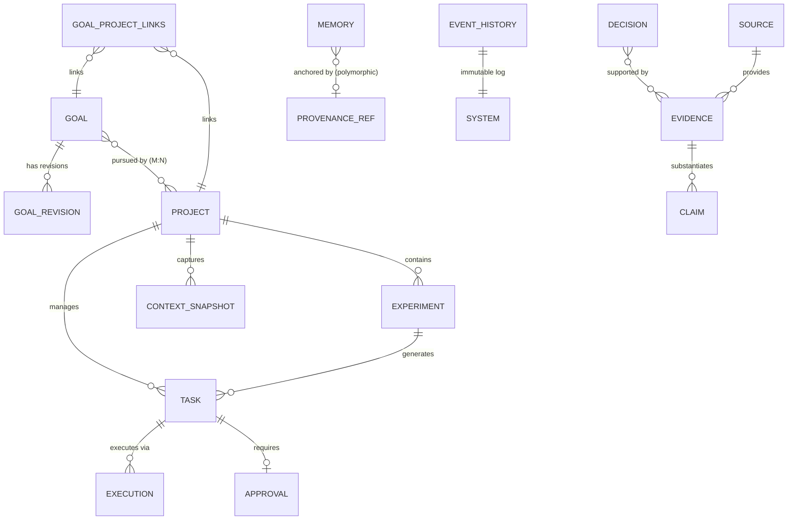

# AIA 統一資料模型與生命週期規格書 (Unified Data Model & Lifecycle Specification)

**文件代號：** AIA-ARCH-DATA-01  
**適用架構：** AIA v2.0 系列規範 (以 [AIA-SPEC-AUDIT-01](file:///home/wade/src/github/aia/docs/specifications/cross-spec-consistency-audit.md) 為基準)  
**底層儲存：** SQLite (WAL 模式)  
**文件狀態：** Normative Architectural Baseline  
**最後更新：** 2026-11-01  

---

## 1. 資料模型核心設計哲學 (Data Architecture Philosophy)

依據 [AIA-08](file:///home/wade/src/github/aia/docs/specifications/AIA-08-Autonomy-Core-Specification.md)、[AIA-10](file:///home/wade/src/github/aia/docs/specifications/AIA-10-Continuity-and-Long-Term-Project-Management-Specification.md)、[AIA-16](file:///home/wade/src/github/aia/docs/specifications/AIA-16-Data-Provenance-Evidence-and-Knowledge-Integrity-Specification.md) 與 [AIA-18](file:///home/wade/src/github/aia/docs/specifications/AIA-18-Autonomy-Core-Integration-and-End-to-End-Reference-Architecture.md)，AIA 採用「雙層狀態持久化模型」：

```text
 ┌────────────────────────────────────────────────────────┐
 │ 1. 歷史事實層 (Append-only Event History - 第一真實來源)│
 │    記錄所有客觀發生的事件、狀態流轉與決策動作，不可竄改。│
 └───────────────────────────┬────────────────────────────┘
                             │
                             ▼ 透過 Context Reconstruction 還原
 ┌────────────────────────────────────────────────────────┐
 │ 2. 當前狀態層 (Reconstructible State Snapshots)        │
 │    包含 Goal, Project, Experiment, Task, Memory 等     │
 │    即使資料庫快照毀損，皆可自 Event 流完整重建。       │
 └────────────────────────────────────────────────────────┘
```

---

## 2. 實體關係圖 (Entity-Relationship Diagram)



---

## 3. 核心實體結構與生命週期定義 (Core Entities)

### 3.1 目標實體 (Goal & GoalRevision)

Goal 描述系統或使用者希望達成的長期狀態。

```sql
CREATE TABLE goals (
    id TEXT PRIMARY KEY,
    parent_goal_id TEXT,                    -- 支援層級樹 (NULL 為頂層目標)
    name TEXT NOT NULL,
    description TEXT NOT NULL,
    level TEXT NOT NULL,                    -- STRATEGIC (戰略), TACTICAL (戰術), OPERATIONAL (運作)
    status TEXT NOT NULL,                   -- ACTIVE, PAUSED, ACHIEVED, SUPERSEDED, ABANDONED
    target_metric_json TEXT,                -- 目標達成度量標的 (如 {"total_asset": 150000})
    current_metric_json TEXT,               -- 當前度量進展
    priority INTEGER NOT NULL DEFAULT 5,    -- 1 (最低) ~ 10 (最高)
    created_at TIMESTAMP NOT NULL,
    updated_at TIMESTAMP NOT NULL,
    FOREIGN KEY (parent_goal_id) REFERENCES goals(id)
);

CREATE TABLE goal_revisions (
    id TEXT PRIMARY KEY,
    goal_id TEXT NOT NULL,
    revision_number INTEGER NOT NULL,
    previous_state_json TEXT NOT NULL,
    new_state_json TEXT NOT NULL,
    reason TEXT NOT NULL,                   -- 修訂理由 (如 "基於三個月回測結果進行目標調整")
    decision_id TEXT,                       -- 關聯之決策 ID
    created_at TIMESTAMP NOT NULL,
    FOREIGN KEY (goal_id) REFERENCES goals(id)
);
```

**狀態轉移機 (Goal Lifecycle)**：
$$\text{DRAFT} \longrightarrow \text{ACTIVE} \longleftrightarrow \text{PAUSED} \longrightarrow \begin{cases} \text{ACHIEVED} \\ \text{SUPERSEDED} \\ \text{ABANDONED} \end{cases}$$

---

### 3.1b Goal ↔ Project 多對多關聯表 (goal_project_links)

Goal 與 Project 之間是 **M:N 關係**：一個 Goal 可由多個 Project 共同追求；一個 Project 可同時服務多個 Goal（例如一個 Coding Project 同時服務「AIA 自主能力研究 Goal」與「Investment Agent 工具改善 Goal」）。

```sql
CREATE TABLE goal_project_links (
    goal_id    TEXT NOT NULL REFERENCES goals(id),
    project_id TEXT NOT NULL REFERENCES projects(id),
    link_type  TEXT NOT NULL DEFAULT 'CONTRIBUTES_TO', -- CONTRIBUTES_TO, VALIDATES, DERIVED_FROM
    created_at TIMESTAMP NOT NULL,
    PRIMARY KEY (goal_id, project_id)
);
```

`projects.primary_goal_id` 是便利欄位，指向最主要的 Goal，供快速查詢使用；完整的多目標關聯必須透過 `goal_project_links` 查詢。

---

### 3.2 專案實體 (Project & Context Snapshot)

Project 是長期工作成果與工作區的實體載體。

```sql
-- 擴充現有 projects 表
ALTER TABLE projects ADD COLUMN status TEXT DEFAULT 'ACTIVE';               -- ACTIVE, ARCHIVED, SUSPENDED
ALTER TABLE projects ADD COLUMN primary_goal_id TEXT REFERENCES goals(id);
ALTER TABLE projects ADD COLUMN latest_snapshot_id TEXT;
ALTER TABLE projects ADD COLUMN pending_issues_json TEXT;                    -- 待決事項列表 (JSON Array)

CREATE TABLE context_snapshots (
    id TEXT PRIMARY KEY,
    project_id TEXT NOT NULL,
    snapshot_type TEXT NOT NULL,            -- MANUAL, PRE_RESTART, POST_CYCLE
    workspace_state_json TEXT NOT NULL,     -- 檔案清單、Git HEAD、環境變數摘要
    active_tasks_json TEXT NOT NULL,        -- 當時未完成的 Task ID 列表
    recent_decisions_json TEXT NOT NULL,    -- 最近關鍵 Decision ID 列表
    pending_issues_json TEXT NOT NULL,      -- 未決問題
    created_at TIMESTAMP NOT NULL,
    FOREIGN KEY (project_id) REFERENCES projects(id)
);
```

---

### 3.3 實驗實體 (Experiment)

Experiment 用於驗證具備不確定性的策略、演算法或長週期科研假設。

```sql
CREATE TABLE experiments (
    id TEXT PRIMARY KEY,
    project_id TEXT NOT NULL,
    goal_id TEXT NOT NULL,
    name TEXT NOT NULL,
    hypothesis TEXT NOT NULL,               -- 實驗核心假設 (如 "加入重大性檢驗閘道能降低 40% Token 消耗")
    experiment_type TEXT NOT NULL,          -- CAPABILITY, STRATEGY, SYSTEM, CROSS_DOMAIN
    status TEXT NOT NULL,                   -- DRAFT, RUNNING, EVALUATING, CONCLUDED, ABORTED
    baseline_metrics_json TEXT NOT NULL,    -- 基準線度量
    current_metrics_json TEXT,              -- 實驗組度量
    iteration_count INTEGER DEFAULT 0,
    created_at TIMESTAMP NOT NULL,
    concluded_at TIMESTAMP,
    FOREIGN KEY (project_id) REFERENCES projects(id),
    FOREIGN KEY (goal_id) REFERENCES goals(id)
);
```

**狀態轉移機 (Experiment Lifecycle)**：
$$\text{DRAFT} \longrightarrow \text{RUNNING} \longleftrightarrow \text{EVALUATING} \longrightarrow \begin{cases} \text{CONCLUDED} \\ \text{ABORTED} \end{cases}$$

---

### 3.4 決策歷程實體 (Decision Record)

每一次深思決策 (Deliberate) 的客觀紀錄，確保決策動機可溯源。

```sql
CREATE TABLE decisions (
    id TEXT PRIMARY KEY,
    project_id TEXT,
    experiment_id TEXT,
    cycle_id TEXT NOT NULL,                 -- 所屬自主閉環 ID
    action_type TEXT NOT NULL,              -- ACT, DEFER, MONITOR, ASK_HUMAN, NO_ACTION
    intent_summary TEXT NOT NULL,           -- 決策意圖摘要
    justification TEXT NOT NULL,            -- 決策理由與深思推演依據
    considered_alternatives_json TEXT,      -- 評估過但捨棄的替代方案
    context_snapshot_id TEXT,               -- 當時環境快照
    governance_result TEXT NOT NULL,        -- ALLOWED, REQUIRED_APPROVAL, BLOCKED
    created_at TIMESTAMP NOT NULL,
    FOREIGN KEY (project_id) REFERENCES projects(id),
    FOREIGN KEY (experiment_id) REFERENCES experiments(id)
);

CREATE TABLE decision_evidence_links (
    decision_id TEXT NOT NULL,
    evidence_id TEXT NOT NULL,
    relevance_note TEXT,
    PRIMARY KEY (decision_id, evidence_id),
    FOREIGN KEY (decision_id) REFERENCES decisions(id),
    FOREIGN KEY (evidence_id) REFERENCES evidence(id)
);
```

---

### 3.5 資料溯源與知識鏈 (Evidence, Source, Claim & Provenance)

貫徹 [AIA-16](file:///home/wade/src/github/aia/docs/specifications/AIA-16-Data-Provenance-Evidence-and-Knowledge-Integrity-Specification.md)，分離資料、來源與主張。

#### 通用知識層與領域 Evidence 分層架構
- **通用知識層 (General Knowledge Layer)**：`sources`、`evidence`、`claims`、`claim_evidence_links` 為全系統共用的客觀事實與溯源底座，不綁定特定領域。
- **領域特化層 (Domain Evidence Layer)**：既有 `investment_decision_evidence` 與 `investment_raw_documents` 保留金融領域的特定欄位（如 ticker、財報指標、market bar、snapshot items）。
- **垂直關聯原則**：兩套系統互補而非競爭。領域決策引用共用 `evidence` 作為依據，亦可將清洗後的結構化事實提煉為共用 `claims` 與 `evidence`，供跨領域 Agent 查閱。

```sql
CREATE TABLE sources (
    id TEXT PRIMARY KEY,
    source_type TEXT NOT NULL,              -- PRIMARY, OFFICIAL, SECONDARY, NEWS, MODEL, TOOL
    uri TEXT NOT NULL,                      -- 來源 URL 或檔案路徑
    publisher TEXT,
    reliability_score REAL DEFAULT 0.5,     -- 0.0 ~ 1.0 來源先驗可靠度
    created_at TIMESTAMP NOT NULL
);

CREATE TABLE evidence (
    id TEXT PRIMARY KEY,
    source_id TEXT NOT NULL,
    content_snippet TEXT NOT NULL,          -- 原始內容摘錄
    content_hash TEXT NOT NULL,             -- SHA256 避免重複抓取
    captured_at TIMESTAMP NOT NULL,
    valid_until TIMESTAMP,                  -- 時間有效性期限 (NULL 表示無特定期限)
    created_at TIMESTAMP NOT NULL,
    FOREIGN KEY (source_id) REFERENCES sources(id)
);

CREATE TABLE claims (
    id TEXT PRIMARY KEY,
    statement TEXT NOT NULL,                -- 具體命題陳述
    assertion_status TEXT NOT NULL,         -- ACCEPTED, REJECTED, UNCERTAIN, CONFLICTED, SUPERSEDED
    is_knowledge INTEGER DEFAULT 0,         -- 1 = 已晉升為跨 Agent 可信知識; 0 = 暫時主張
    created_at TIMESTAMP NOT NULL,
    updated_at TIMESTAMP NOT NULL
);

CREATE TABLE claim_evidence_links (
    claim_id TEXT NOT NULL,
    evidence_id TEXT NOT NULL,
    support_type TEXT NOT NULL,             -- SUPPORTS, REFUTES, QUALIFIES
    PRIMARY KEY (claim_id, evidence_id),
    FOREIGN KEY (claim_id) REFERENCES claims(id),
    FOREIGN KEY (evidence_id) REFERENCES evidence(id)
);
```

#### 記憶表架構調整 (Memories 表擴充)
修正舊版強制綁定外鍵的問題，改以多型 Provenance 欄位追蹤記憶來源：
```sql
-- 擴充現有 memories 表（所有新增欄位均有預設值，100% 向下相容）
ALTER TABLE memories ADD COLUMN provenance_type TEXT DEFAULT 'INFERENCE';
    -- 允許值：FACT_BASED | INFERENCE | HYPOTHESIS | USER_PREFERENCE | AGENT_DECISION
ALTER TABLE memories ADD COLUMN provenance_ref_type TEXT DEFAULT 'NONE';
    -- 允許值：EVIDENCE | SOURCE | MEMORY | CONTEXT_SNAPSHOT | DECISION | NONE
    -- 說明：指向哪種實體作為此記憶的 Provenance 錨點
ALTER TABLE memories ADD COLUMN provenance_ref_id TEXT;
    -- 對應 provenance_ref_type 實體的 ID（多型引用，非外鍵約束）
ALTER TABLE memories ADD COLUMN confidence REAL DEFAULT 0.5;
    -- 0.0 ~ 1.0 信心程度
```

> [!IMPORTANT]
> **不採用** `claim_id NOT NULL` 或 `evidence_id NOT NULL` 的強制外鍵。強制要求的是 **Provenance 鏈的完整性**：每筆 Memory 必須能回答「這條記憶從哪裡來的？」——可接受的錨點包含 Evidence、Source、Memory（先驗推導）、Context Snapshot、或先前 Decision。若 `provenance_type ≠ NONE`，則 `provenance_ref_id` 不得為空。

---

### 3.6 治理、審批與三軌事件體系 (Governance, Approvals & Triple-Event Streams)

#### A. 三軌事件責任分離原則 (The Triple-Event Architecture)
為避免日誌職責不清與相互踩踏，AIA 嚴格劃分三種事件流的責任：

| 資料結構 | 核心職責 | 生命週期與範圍 | 典型事件範例 |
|---|---|---|---|
| **`execution_events`**<br/>*(既有表 001)* | 記錄單次 Task/Execution 內部的**微觀執行細節** | 綁定 `execution_id`，短期工單遙測 | Agent 呼叫 Tool、命令輸出片段、Worker 心跳 |
| **`event_history`**<br/>*(新增表 007)* | 記錄全系統長期存在的**業務事實與自主性演進事件** | 全域不可竄改，長期留存；Continuity 重建的第一事實來源 | Agent 發現市場異常、目標狀態變更、重大推論成立、自我修正生效 |
| **`audit_logs`**<br/>*(既有表 001/002，擴充於 009)* | 記錄**誰在何時執行/申請何項受治理操作** | 全域安全審計日誌，法規與安全合規邊界 | 提交代碼修改提案、觸發高預算呼叫、審批通過/駁回、緊急停止觸發 |

三者互相關聯但職責獨立：`audit_logs` 可關聯 `decision_id` 或 `task_id`；`event_history` 記錄宏觀狀態轉移；`execution_events` 封裝於單次執行內部。

```sql
-- 1. 全域不可竄改業務事件流 (event_history)
CREATE TABLE event_history (
    id INTEGER PRIMARY KEY AUTOINCREMENT,
    event_type TEXT NOT NULL,               -- GOAL_REVISED, TASK_QUEUED, EMERGENCY_STOPPED...
    aggregate_type TEXT NOT NULL,           -- GOAL, PROJECT, EXPERIMENT, TASK, GOVERNANCE
    aggregate_id TEXT NOT NULL,
    actor_id TEXT NOT NULL,                 -- AGENT:xxx, USER, SYSTEM
    payload_json TEXT NOT NULL,
    occurred_at TIMESTAMP NOT NULL
);
CREATE INDEX idx_event_history_aggregate ON event_history(aggregate_type, aggregate_id);

-- 2. 治理審批實體 (approvals)
CREATE TABLE approvals (
    id TEXT PRIMARY KEY,
    task_id TEXT,
    decision_id TEXT,
    operation_type TEXT NOT NULL,           -- CODE_MODIFICATION, SYSTEM_CONFIG, LARGE_EXPENSE
    risk_tier TEXT NOT NULL,                -- LOW, MEDIUM, HIGH, CRITICAL
    requested_by_agent_id TEXT NOT NULL,
    status TEXT NOT NULL,                   -- PENDING, APPROVED, REJECTED, EXPIRED, CANCELLED
    human_comment TEXT,
    requested_at TIMESTAMP NOT NULL,
    responded_at TIMESTAMP,
    expires_at TIMESTAMP NOT NULL,
    FOREIGN KEY (task_id) REFERENCES tasks(id),
    FOREIGN KEY (decision_id) REFERENCES decisions(id)
);

-- 3. 擴充既有 audit_logs 表 (不重複新建 policy_audit_logs 表)
-- 既有欄位: id, sequence, actor_type, actor_id, action, target_type, target_id, timestamp, request_id, source, metadata_json
ALTER TABLE audit_logs ADD COLUMN policy_id TEXT DEFAULT '';
ALTER TABLE audit_logs ADD COLUMN decision_id TEXT DEFAULT '';
ALTER TABLE audit_logs ADD COLUMN approval_id TEXT DEFAULT '';
ALTER TABLE audit_logs ADD COLUMN risk_tier TEXT DEFAULT 'LOW';
ALTER TABLE audit_logs ADD COLUMN governance_action TEXT DEFAULT '';
CREATE INDEX idx_audit_decision ON audit_logs(decision_id);
CREATE INDEX idx_audit_approval ON audit_logs(approval_id);
```

---

## 4. 既有 Schema 向下相容矩陣 (Backward Compatibility)

現行資料表（已內建於 Commit `7597902`，包含 Migration Version 1 ～ 6）保留率達 **100%**：

| 現有資料表 / 模組 | 所屬 Migration | 處理策略 | 相容性保證 |
|---|---|---|---|
| `projects` | 001 | 擴充 `primary_goal_id` 與 `status`；M:N 關聯透過新增 `goal_project_links` 表 | 預設值保證相容 |
| `agents` | 001 | 沿用並擴充 `agent_type` 與 capabilities | 完全向下相容 |
| `tasks` | 001 | 沿用現有狀態機，新增 `experiment_id` 欄位 | 完全向下相容 |
| `task_dependencies` | 001 | 沿用 | 完全向下相容 |
| `executions` | 001 | 沿用 | 完全向下相容 |
| `execution_events` | 001 | 專責微觀執行日誌，與全域 `event_history` 分流 | 完全向下相容 |
| `memories` | 001 | 擴充 `provenance_type`、`provenance_ref_type`、`provenance_ref_id` 與 `confidence` | 預設值保證相容 |
| `memory_candidates` | 001 | 沿用，作為短期記憶候選審核載體 | 完全向下相容 |
| `artifacts` | 001 | 沿用 | 完全向下相容 |
| `audit_logs` | 001, 002 | 擴充治理專屬欄位（`policy_id`, `decision_id`, `approval_id`, `risk_tier`） | 預設值保證相容，不重複建表 |
| `investment_*` 表 (全 16 張表)| 003, 004, 005 | 原樣保留，作為 Phase 3 Pilot 記帳、管線與預測基石 | 業務邏輯 100% 沿用，通用 Evidence 垂直鏈結 |
| `schedules` | 006 | 沿用，支援 Cron 與自動化週期任務排程 | 完全向下相容 |

本統一資料模型已徹底消除跨規格歧異，並為後續 Migration (007 ～ 012) 提供了精確欄位規範。
