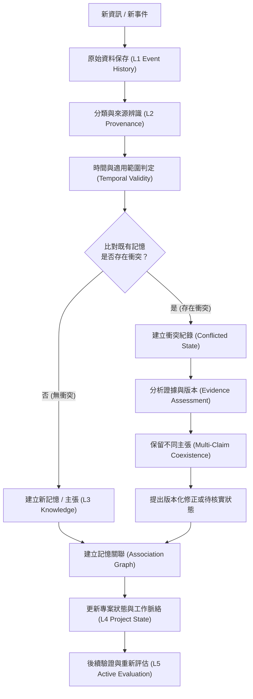

# **AIA 一致性記憶架構（Consistent Memory Architecture）**

## **一、先區分四種記憶**

人類往往把經歷、知識、理解、習慣混在一起。AIA 應該分開保存。

| 記憶類型 | 保存內容 | 例子 |
| ----- | ----- | ----- |
| 情節記憶 Episodic | 曾經發生的事情 | 2026/11/1，使用者決定投資實驗改採虛擬交易 |
| 語意記憶 Semantic | 已知事實與知識 | 台積電股票代號是 2330 |
| 程序記憶 Procedural | 如何完成某件事情 | 如何執行投資評估與風險分析 |
| 工作記憶 Working | 目前正在處理的狀態 | AIA 正在進行 Phase 1，準備 Migration 007 |

這四種記憶不能互相取代。

例如：

* 記得使用者曾經做過某項決定，不代表理解決定的原因。  
* 知道某項技術知識，不代表知道它在目前專案是否適用。  
* 記得某個專案正在進行，不代表知道上次進行到哪裡。

AIA 必須能夠把它們串聯起來。

## **二、最重要的原則：歷史不能改寫，理解可以修正**

我認為這是整個記憶系統的核心。

假設 AIA 在某一天做出一項投資判斷：

> 台積電未來一週可能上漲，因此決定增加持股。

一週後發現判斷錯誤。

AIA 不應該把原本的記憶改成：

> 當時判斷台積電不適合增加持股。

這是竄改歷史。

正確做法是保留完整過程：

1. 原始決策  
   2026/11/1：判斷台積電可能上漲，決定增加持股。  
2. 實際結果  
   2026/11/8：股價下跌，投資組合產生損失。  
3. 重新分析  
   發現原先對國際市場風險的評估不足。  
4. 修正認知  
   對於台積電的短期價格預測，需要納入國際半導體景氣與美股市場變化。  
5. 後續驗證  
   觀察新評估方法是否改善預測校準與投資決策。

這樣 AIA 不只是記得自己做過什麼，也知道：

* 當時為什麼這樣做。  
* 當時掌握哪些資訊。  
* 後來發生什麼事情。  
* 哪些判斷被證實，哪些被推翻。  
* 自己因此改變了什麼。

這就是時間連續性與自我修正的交集。

## **三、記憶不能只有一個資料庫，必須有權威層級**

我建議 AIA 將記憶分成五個層次。

L1 — Event History

不可任意修改的歷史事實

發生過什麼、何時發生、由誰做出決策

L2 — Evidence & Provenance

證據與來源鏈

資訊從哪裡來、是否可信、何時有效

L3 — Knowledge & Memory

經過整理的知識與記憶

事實、推論、假設、經驗、使用者決策

L4 — Context & Project State

目前理解的世界與工作狀態

專案進度、人物關係、目標、未完成事項

L5 — Active Context

目前 Session 真正使用的記憶

依照當前任務選取相關資訊，而非載入全部記憶

這五層的關係不是單向資料流，而是相互關聯的知識體系。

例如，L4 的 Project State 可以因新事件而改變，但不能反過來修改 L1 的歷史。

這也呼應 AIA-10 的 Continuity、AIA-16 的 Provenance，以及 AIA-18 的整體架構。

## **四、如何避免 AIA 記錯？**

這裡需要設計一個記憶寫入流程。

我建議任何重要資訊都必須經過以下步驟：

有幾個規則尤其重要：

1. 新資訊不能因為比較新，就自動取代舊資訊。  
2. 模型推論不能自動升級成史實。  
3. 多個來源引用同一份資料，不算多份獨立證據。  
4. 資料可能具有時間效力，例如某家公司目前的執行長，不代表十年前也是同一人。  
5. 發現矛盾時，先保留矛盾，不要急著選一個答案。  
6. 修正記憶時，建立新版本，保留原版本與修正原因。

這樣才能避免 AIA 在長期運作中不斷累積錯誤。

## **五、如何避免 AIA 忘記？**

這是另一個問題。

我認為不能依靠每次 Session 都把所有記憶塞進模型 Context。

那樣會遇到 Context Window 限制，而且資料越多，重要資訊越容易被淹沒。

應該採取三種機制：

1\. 永久保存（Persistent Storage）

重要事件、決策、使用者確認的設定、知識版本，寫入持久化資料庫。

不能因為 Memory 摘要更新，就刪除原始紀錄。

2\. 關聯式召回（Associative Retrieval）

記憶不能只靠關鍵字搜尋。

例如，使用者說：

「繼續修改那份投資規格。」

AIA 必須能找到：

* 哪一份規格。  
* 最近一次修改版本。  
* 當時的設計決策。  
* 尚未解決的問題。  
* 相關的資料模型。  
* 與其他規格的依賴關係。

這不是搜尋一份文件，而是重建工作脈絡。

3\. 定期一致性檢查（Consistency Audit）

AIA 必須主動檢查：

* 記憶是否互相矛盾。  
* Project State 是否落後於最新事件。  
* Goal 是否已經失效。  
* 重要決策是否缺少原因。  
* 長期任務是否失去進度。  
* 知識是否已經過期。

注意：這不代表定期重寫所有記憶，而是找出需要處理的問題。

## **六、我認為 AIA 還缺少一個重要概念：Memory Governance**

現有 AIA-10、AIA-11、AIA-16 已經分別處理時間連續性、自我修正、資料來源與知識完整性。

但這三者之間，還需要一套統一的記憶治理機制。

我建議新增一個核心子系統：

Memory Integrity & Governance

它不負責產生智慧，也不負責決定目標，而是確保 AIA 的記憶可以被信任。

其責任包括：

| 功能 | 責任 |
| ----- | ----- |
| Memory Write Control | 控制記憶寫入與版本建立 |
| Memory Classification | 區分事件、事實、推論、假設與經驗 |
| Provenance Management | 保存來源及證據鏈 |
| Temporal Management | 管理發生時間與有效時間 |
| Conflict Detection | 發現記憶衝突 |
| Memory Reconciliation | 提出記憶修正與整合 |
| Context Reconstruction | 重建過去與現在的工作脈絡 |
| Consistency Audit | 定期檢查記憶一致性 |
| Memory Retrieval | 依照任務召回相關記憶 |

這個子系統應該是 Autonomy Core 可以使用的共用能力，而不是 Investment、Coding、Writing 各自維護一套。

## **七、三個 Agent 的記憶實驗**

這個設計很適合直接透過三個 Domain 驗證。

| Agent | 記憶一致性的驗收方式 |
| ----- | ----- |
| Investment | 記得每次買賣的理由、當時市場資訊、預測與實際結果，不因後續虧損改寫原判斷 |
| Coding | 記得程式架構、修改歷史、錯誤原因、修正方法，不重複犯已經找出原因的錯誤 |
| Writing | 記得人物年表、歷史事件、各卷設定與使用者確認的世界觀，不因新章節而破壞舊設定 |

尤其是 Writing Agent。

假設你寫了八卷歷史小說，第一卷設定某人物在某年死亡，第七卷卻讓他繼續活動。

一般模型可能因為當下生成需求而忽略前面的設定。

AIA 應該能主動發現矛盾，追查原始設定，並提出修正，而不是自行選擇一個版本。

## **八、我對 AIA 的最終建議**

我會把記憶系統的成功標準定義成五件事：

1. 不失憶： 已經發生的重要事件與決策可以永久追溯。  
2. 不亂記： 事實、推論、假設、意見不會混在一起。  
3. 不亂改： 歷史不可覆寫，認知可以版本化修正。  
4. 不混淆： 不同專案、不同時間、不同領域的記憶不會任意串錯。  
5. 不停止學習： 新經驗能修正舊認知，並影響未來的判斷。

這裡還有一個我認為很關鍵的區別：

人類常常是先忘記，再重新回憶；AIA 應該是先保存，再重新理解。

這會讓 AIA 的時間連續性有一個非常穩固的基礎。

我建議不要急著新增大量資料表，也不要立即做一套獨立的 Memory Engine。先把這些原則整合成 AIA-10、AIA-16、AIA-18 的共同設計要求，再檢查目前 Phase 1 的資料模型是否足以支撐它。

因為真正需要解決的不是「AIA 能存多少記憶」，而是：

AIA 能否在一年、五年甚至十年後，仍然清楚知道自己曾經知道什麼、為什麼知道、哪些事情已經改變，以及自己為什麼改變了認知。

