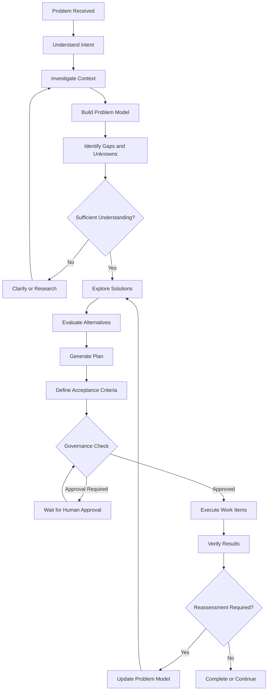

# AIA-22 — Complex Problem Analysis & Planning Specification

> [!NOTE]
> **架構重整與收攏公告 (Consolidated Architecture Specification)**
> 本規範為 AIA 歷史基準規範（規格編號已於 AIA-22 永久封頂）。為杜絕規格膨脹與重複定義，本規範之現行核心標準已正式收攏重整至 **[Volume 2: Cognitive Loop, Memory & Planning](file:///home/wade/src/github/aia/docs/specifications/volume-2-cognitive-loop-and-planning.md)**。最新架構與維護基準請以對應之 Volume 為主，完整六大核心卷軸總覽請參閱 [Specification Catalog (README.md)](file:///home/wade/src/github/aia/docs/specifications/README.md)。

**文件代號：** AIA-22  
**文件名稱：** 複雜問題分析與自主規劃規格  
**英文名稱：** Complex Problem Analysis & Planning Specification  
**版本：** v1.0  
**文件狀態：** 正式規格 (Normative Specification) · 程式碼實作完成 (Implemented in Migration `018` & Autonomy Loop)  
**適用系統：** AIA (Autonomous Intelligence Architecture)  
**適用範圍：** All Domains  
**依賴規格：** AIA-01、AIA-02、AIA-03、AIA-08、AIA-09、AIA-10、AIA-11、AIA-16、AIA-17、AIA-18、AIA-21

---

## 1. Purpose

### 1.1 文件目的

本文件定義 AIA 面對複雜、開放式、尚未充分定義，或無法透過單一 Task 完成的問題時，應具備的自主分析與規劃能力。

AIA 不應只是一個接收指令、拆分 Task、呼叫 Agent、等待結果的工作執行系統。

AIA 必須能夠：

1. 理解人類提出的目標與實際意圖。
2. 發現問題中未明確表達的需求、限制及未知事項。
3. 主動探索現有資料、文件、環境及資源。
4. 建立問題模型，辨識問題的結構與相互依賴。
5. 自行研究並提出可行方案。
6. 比較不同方案的成本、效益、風險及限制。
7. 建立可執行、可驗收、可恢復的計畫。
8. 在執行中發現原始分析或計畫的不足。
9. 根據新證據重新分析、調整或重建計畫。
10. 保留分析、決策、計畫及修正的歷史，使後續 Agent 能延續工作。

核心要求：

**當人類只提供目標，而沒有提供解決方法時，AIA 必須能夠自行探索問題，建立解決方法，而不是等待人類逐步告訴它應該怎麼做。**

### 1.2 設計原則

本能力遵循以下原則：

- Goal-oriented：以目標為核心，不以 Task 數量或執行次數為成果。
- Evidence-based：分析與決策應有證據支持。
- Uncertainty-aware：明確區分事實、假設、未知及推測。
- Recursive：複雜問題可以進一步分析成子問題。
- Adaptive：計畫可以根據新資訊調整。
- Persistent：分析成果必須持久化，不依賴單次 Agent Session。
- Governed：分析與執行均受 AIA Governance 控制。
- Domain-independent：共用分析能力，不重複實作於各 Domain。
- Human-directed：人類決定最終目標與重大方向，Agent 可以提出建議，但不能自行取得超出授權的權限。

---

## 2. Scope and Responsibility

### 2.1 本規格涵蓋範圍

AIA-22 定義以下能力：

| 能力 | 說明 |
|---|---|
| Intent Understanding | 理解目標與使用者意圖 |
| Problem Discovery | 探索問題及潛在需求 |
| Context Investigation | 調查現況、資源及限制 |
| Problem Modeling | 建立問題模型 |
| Gap Analysis | 發現缺口及未知事項 |
| Dependency Analysis | 分析工作與問題依賴 |
| Solution Exploration | 探索可行方案 |
| Alternative Evaluation | 比較方案 |
| Plan Generation | 產生執行計畫 |
| Recursive Decomposition | 遞迴拆解問題 |
| Plan Reassessment | 重新評估與調整計畫 |
| Acceptance Design | 建立驗收條件 |

### 2.2 非本規格負責範圍

AIA-22 不重新定義下列既有能力：

| 能力 | 責任規格 |
|---|---|
| Autonomy Core 與自主行為迴圈 | AIA-08 |
| Initiative 與 Goal Evolution | AIA-09 |
| 長期 Project Continuity | AIA-10 |
| Self-Correction 與 Learning | AIA-11 |
| Agent Delegation | AIA-12 |
| Autonomy Evaluation | AIA-13 |
| Experiment Lifecycle | AIA-15 |
| Evidence、Provenance、Knowledge Integrity | AIA-16 |
| Governance 與 Human Oversight | AIA-17 |
| 整體架構整合 | AIA-18 |
| 書籍與寫作 Project 規格 | AIA-20 |
| Brief 與 Clarification | AIA-21 |

AIA-22 的定位是將上述能力連接成一套可持續運作的複雜問題分析與規劃機制。

### 2.3 關鍵區別：Problem Analysis 不等於 Task Decomposition

Task Decomposition 的起點是已知工作。

例如：

- 讀取第 1 章。
- 檢查第 2 章。
- 產生報告。
- 執行測試。

Problem Analysis 的起點則是尚未知道應該做什麼。

例如：

「請檢查這本已經完成的小說，看看是否符合所有規範。」

AIA 必須先自行發現：

- 有哪些規範文件？
- 規範之間是否一致？
- 作品有哪些章節與分卷？
- 需要檢查哪些層次？
- 哪些內容可以自動驗證？
- 哪些內容需要專業判斷？
- 是否需要歷史資料研究？
- 如何避免誤判？
- 如何確認整體稽核已經完成？

直到問題結構與工作範圍足夠明確，才進入正式 Task Decomposition。

---

## 3. Architectural Position

### 3.1 系統定位

Problem Analysis & Planning 是 Autonomy Core 的共用能力。

它不是獨立 Domain Agent，也不是單純的 Prompt Template。

```text
                  Human / Initiative
                         |
                         v
                 Autonomy Core
                         |
             Problem Analysis & Planning
                         |
          +--------------+--------------+
          |              |              |
          v              v              v
      Investment       Coding         Writing
       Domain          Domain          Domain
          |              |              |
          +--------------+--------------+
                         |
                         v
                  Agent / agy
                         |
                         v
                   Execution
                         |
                         v
                Verify & Reassess
                         |
                         +------> Analysis
```

### 3.2 職責分工

**Autonomy Core**

- 決定是否需要進行問題分析。
- 管理分析生命週期。
- 決定是否需要重新分析。
- 評估目標與目前計畫是否仍然一致。

**Problem Analysis & Planning**

- 建立問題模型。
- 分析問題結構。
- 探索可行方案。
- 建立與維護執行計畫。
- 管理問題拆解與計畫版本。

**Domain Agent**

- 提供領域知識。
- 執行專業分析。
- 提出領域限制與驗證方法。
- 評估專業結論是否合理。

**agy Harness**

- 執行 LLM 推理。
- 使用授權工具調查、閱讀、研究及分析。
- 產生分析結果與建議。

**AIA Runtime**

- 管理 Analysis、Problem Model、Plan 及 Work Items。
- 保存狀態與版本。
- 管理 Task、Worker 與 Execution。
- 執行 Governance。
- 處理中斷、恢復與 Audit。

agy 不直接管理 AIA 的持久化狀態，也不能自行決定跳過 Governance。

---

## 4. Problem Analysis Lifecycle

### 4.1 整體流程



### 4.2 Phase A — Understand Intent

分析 Agent 必須先理解問題的真正目標。

應辨識：

- 使用者明確提出的目標。
- 使用者期待的成果。
- 不能違反的限制。
- 未明確表達但可能影響成果的條件。
- 使用者已經提供的資料。
- 需要向使用者確認的事項。

必須區分：

1. User Goal：使用者想達成的結果。
2. Requested Method：使用者指定的方法。
3. Constraints：必須遵守的限制。
4. Assumptions：目前尚未確認的假設。
5. Success Criteria：如何判斷成功。

Agent 不得擅自將自己的偏好取代使用者的目標。

若使用者只要求分析，不能自動擴張為修改或執行。

### 4.3 Phase B — Investigate Context

AIA 應先檢查已經存在的資料與資源，而不是立即重新建立一套工作。

可調查的範圍包括：

- Project Manifest。
- 現有文件與目錄。
- 歷史決策。
- 已完成的 Task。
- 未完成工作。
- Knowledge 與 Memory。
- 現有系統架構。
- 可用工具與 Agent。
- 外部資料來源。
- 使用者設定的限制。

調查結果應記錄：

- 找到了什麼。
- 沒找到什麼。
- 哪些資料可以信任。
- 哪些資料需要進一步驗證。
- 哪些資料已經過期。
- 哪些資料彼此衝突。

不得把「尚未找到」直接解釋成「不存在」。

### 4.4 Phase C — Build Problem Model

AIA 必須將原始問題轉換為結構化問題模型。

Problem Model 至少應包含：

| 欄位 | 說明 |
|---|---|
| Objective | 主要目標 |
| Desired Outcomes | 預期成果 |
| Scope | 工作範圍 |
| Constraints | 限制條件 |
| Assumptions | 暫定假設 |
| Known Facts | 已知事實 |
| Unknowns | 未知事項 |
| Dependencies | 依賴關係 |
| Risks | 潛在風險 |
| Stakeholders | 相關對象 |
| Resources | 可用資源 |
| Success Criteria | 成功條件 |
| Open Questions | 尚未解決的問題 |

問題模型必須保留來源與可信程度。

不能將 Agent 的推論直接提升為已確認事實。

### 4.5 Phase D — Gap and Conflict Discovery

AIA 必須主動尋找：

- 資料缺口。
- 目標不明確。
- 規範衝突。
- 資源不足。
- 技術限制。
- 未知依賴。
- 潛在風險。
- 無法驗收的需求。
- 相互矛盾的假設。

每個問題至少應記錄：

- 問題描述。
- 發現來源。
- 影響範圍。
- 嚴重程度。
- 目前信心。
- 建議處理方式。
- 是否需要人類介入。

AIA 可以自行研究能夠透過資料取得解決的問題；涉及使用者意圖、重大方向或不可逆決策時，應透過 AIA-21 的 Clarification 機制處理。

### 4.6 Phase E — Solution Exploration

AIA 不應只提出第一個想到的解法。

對於具有重大影響或多種可行方法的問題，應至少探索合理的替代方案。

方案分析應包含：

- 方案描述。
- 預期效益。
- 實施成本。
- 時間需求。
- 技術可行性。
- 風險。
- 可逆性。
- 依賴條件。
- 驗證方法。

不要求所有問題都產生多個方案。

簡單問題可以直接提出單一方案；複雜問題則應避免過早收斂。

Agent 應說明為何選擇某方案，以及為何排除其他方案。

### 4.7 Phase F — Plan Generation

確認方案後，AIA 建立正式計畫。

Plan 至少包含：

- 目標。
- 工作範圍。
- 執行階段。
- Work Items。
- 依賴關係。
- 資源配置。
- Agent 分工。
- 執行順序。
- 驗收條件。
- 風險控制。
- 人工批准節點。
- 中斷與恢復策略。

Plan 必須是可追蹤的持久化物件，而不是只存在於 Agent 回覆中的文字。

### 4.8 Phase G — Execute and Reassess

執行不代表分析結束。

AIA 應持續比較：

- 原始問題模型。
- 當前實際狀況。
- 原始計畫。
- 已完成成果。
- 新發現的問題。
- 尚未達成的目標。

若發現原計畫不再適用，必須重新評估。

不得為了維持原始計畫而忽略新證據。

---

## 5. Recursive Problem Decomposition

### 5.1 遞迴分析原則

複雜問題可能包含多層子問題。

AIA 必須允許每個子問題再次進行分析，而不只是將它轉成一個 Task。

例如：

```text
Whole-Book Compliance Audit
|
+-- Understand Book Requirements
|   |
|   +-- Identify Rule Documents
|   +-- Extract Applicable Rules
|   +-- Resolve Rule Conflicts
|
+-- Audit Individual Chapters
|   |
|   +-- Check Chapter Structure
|   +-- Check Content Compliance
|   +-- Check Historical Claims
|
+-- Audit Volume Consistency
|   |
|   +-- Compare Volume Outline
|   +-- Check Character Development
|   +-- Check Chronology
|
+-- Audit Whole-Book Consistency
    |
    +-- Character Timeline
    +-- Event Timeline
    +-- Relationship Consistency
    +-- Historical Evidence
```

每個節點可以有自己的：

- Problem Model。
- Analysis。
- Plan。
- Work Items。
- Acceptance Criteria。
- Findings。

### 5.2 分析深度與停止條件

遞迴分析不得無限制展開。

AIA 應根據以下條件判斷是否繼續拆解：

- 子問題是否仍然複雜。
- 是否存在未解決的依賴。
- 是否能明確定義驗收條件。
- 是否有必要進行獨立研究。
- 拆解是否能提高執行品質。
- 額外分析成本是否合理。

當子問題已經足夠明確、可執行、可驗收時，才轉換成 Work Item。

應支援：

- 最大分析深度。
- 最大 Work Item 數量。
- 最大分析資源預算。
- 最大重試次數。
- 停止與等待條件。

上述限制由 AIA Runtime 管理，不允許 Agent 無限制擴張工作。

### 5.3 分析不是越細越好

AIA 不應把每個動作都拆成獨立 Task。

例如「讀取一份 Markdown 文件」通常不需要再拆成數十個子問題。

只有當拆解能改善獨立性、驗收性、資源分配或風險控制時，才應繼續分解。

---

## 6. Problem Model and Plan Versioning

### 6.1 Problem Entity

建議資料結構：

```go
type Problem struct {
    ID          string
    ProjectID   string
    ParentID    string
    Title       string
    Description string
    Objective   string
    Scope       string
    Status      string
    Priority    string

    CurrentModelVersion int
    CurrentPlanVersion  int

    CreatedAt   time.Time
    UpdatedAt   time.Time
}
```

ParentID 用於建立問題階層。

### 6.2 Problem Model

```go
type ProblemModel struct {
    ID          string
    ProblemID   string
    Version     int

    Objectives      []ModelItem
    Constraints     []ModelItem
    KnownFacts      []ModelItem
    Assumptions     []ModelItem
    Unknowns        []ModelItem
    Dependencies    []ModelItem
    Risks           []ModelItem
    SuccessCriteria []ModelItem

    CreatedAt   time.Time
}
```

ModelItem 必須能追溯：

- Source。
- Evidence Reference。
- Confidence。
- Status。
- Created By。
- Created At。

### 6.3 Analysis Record

每次分析都必須建立獨立記錄。

```go
type AnalysisRecord struct {
    ID          string
    ProblemID   string
    ModelVersion int

    AnalysisType string
    InputRefs    []string
    Findings     []string
    Conclusions  []string
    OpenQuestions []string

    AgentID     string
    ExecutionID string

    CreatedAt   time.Time
}
```

分析紀錄不得覆蓋歷史紀錄。

### 6.4 Plan Entity

```go
type Plan struct {
    ID          string
    ProblemID   string
    Version     int

    Objective   string
    Strategy    string
    Status      string

    WorkItems   []string
    Dependencies []string
    AcceptanceCriteria []string

    Supersedes  string
    CreatedAt   time.Time
}
```

每次重要計畫變更，都必須建立新版本。

不得直接覆寫原始計畫。

### 6.5 Plan Change Record

計畫變更必須說明：

- 原計畫內容。
- 新計畫內容。
- 變更原因。
- 新發現的證據。
- 受影響的 Work Items。
- 對成本與風險的影響。
- 是否需要人類批准。

---

## 7. Evidence, Uncertainty and Knowledge Integrity

### 7.1 事實與推論分離

AIA 必須明確區分：

1. Verified Fact：有可靠證據支持的事實。
2. Supported Inference：有證據支持的合理推論。
3. Assumption：為了繼續分析而暫時採用的假設。
4. Hypothesis：尚待驗證的假說。
5. Unknown：目前無法確認的事項。
6. Conflict：不同來源或規範之間的衝突。

不得將推測寫入 Verified Fact。

### 7.2 Confidence

Confidence 是對特定判斷的信心，不是事實正確性的替代證據。

AIA 應保存：

- 判斷內容。
- 判斷依據。
- 來源品質。
- 不確定因素。
- 信心程度。
- 後續驗證結果。

不能因為 Agent 信心高，就免除驗證。

### 7.3 Evidence Provenance

所有重要結論應能追溯到：

- 文件。
- 文件版本。
- 行數或段落。
- 外部來源。
- 工具執行結果。
- Agent Analysis Record。
- 人類確認紀錄。

具體的 Provenance 與 Knowledge Integrity 依 AIA-16 執行。

### 7.4 未知事項處理

未知事項可以採取：

- Research：自行研究。
- Clarify：詢問人類。
- Provisional Assumption：採用暫定假設。
- Defer：延後處理。
- Block：阻止相關工作繼續。

是否能採用假設，應考量錯誤成本與決策可逆性。

---

## 8. Plan Reassessment and Adaptation

### 8.1 重新分析觸發條件

以下事件應觸發 Reassessment：

- 新證據推翻原始假設。
- 發現重大規範衝突。
- 執行結果與預期不符。
- Work Item 持續失敗。
- 發現原先未納入的依賴。
- 目標或限制發生變化。
- 資源不足。
- 新風險出現。
- 驗收條件無法達成。
- 人類提出新的方向。

### 8.2 Reassessment 流程

```text
Trigger
   |
   v
Collect New Evidence
   |
   v
Compare Against Current Model
   |
   v
Identify Impact
   |
   v
Evaluate Existing Plan
   |
   v
Choose Action
   |
   +-- Continue
   |
   +-- Modify Plan
   |
   +-- Rebuild Plan
   |
   +-- Request Clarification
   |
   +-- Pause / Stop
```

### 8.3 不可將失敗視為單一原因

當計畫無法完成時，AIA 應區分：

- 問題模型錯誤。
- 假設不成立。
- 資料不足。
- 分析錯誤。
- 計畫不合理。
- 執行失敗。
- 工具或環境故障。
- 驗收標準不合理。
- 外部條件改變。

修正時應針對真正原因，而不是一律重新執行原 Task。

### 8.4 Plan Stability

AIA 不應因為每次取得一筆新資料，就任意修改計畫。

計畫變更必須具有可說明的理由。

應考量：

- 新資訊的重要性。
- 對原目標的影響。
- 變更成本。
- 已完成工作的重用程度。
- 重新執行的風險。
- 是否值得修改。

---

## 9. Decision and Governance

### 9.1 分析權限

Agent 可以：

- 自行分析問題。
- 探索可行方案。
- 提出工作計畫。
- 發現新的子問題。
- 建議調整優先順序。
- 建議取消低價值工作。
- 提出目標調整建議。

但不能因此自動取得執行所有方案的權限。

### 9.2 需要人類批准的情況

依 AIA-17 的 Governance Policy，以下情況應進行適當批准：

- 改變人類指定的主要目標。
- 擴張原定 Project 範圍。
- 執行重大不可逆操作。
- 使用超出授權的資源。
- 修改核心治理設定。
- 修改受保護的 AIA 核心程式。
- 涉及真實資金或外部不可逆交易。
- 可能破壞使用者既有成果的操作。

### 9.3 分析與執行分離

分析本身不代表獲得執行授權。

例如：

「建議重寫整個 Project。」

這可以是分析結論，但不代表 AIA 可以直接刪除或重建原有 Project。

### 9.4 Human-in-the-loop

AIA 應避免將所有問題都交給人類。

下列事項可自行處理：

- 查找既有文件。
- 建立初步問題模型。
- 分析依賴。
- 比較一般性方案。
- 建立暫定計畫。
- 執行授權範圍內的可逆工作。

下列事項應視情況詢問：

- 重要需求不明確。
- 方案涉及不同價值取捨。
- 規範存在無法自行解決的衝突。
- 重大風險無法由 Agent 合理承擔。
- 需要改變人類原始意圖。

AIA-21 負責 Clarification Request 與 Brief 更新。

---

## 10. Integration with Autonomy Core

### 10.1 Autonomy Loop Integration

AIA-22 必須整合 AIA-08 定義的自主行為迴圈：

```text
Observe
   |
Recall
   |
Assess
   |
Discover
   |
Deliberate
   |
Problem Analysis & Planning
   |
Decision
   |
Governance Check
   |
Execute
   |
Verify
   |
Learn
   |
Reassess
```

Problem Analysis & Planning 不應取代 Autonomy Loop，而是讓 Deliberate、Decision、Execute 之間具有完整的問題模型與計畫。

### 10.2 Initiative Integration

當 AIA-09 的 Initiative Discovery 發現值得處理的問題時，可以建立 Problem。

例如：

- 發現 Investment 策略長期失效。
- 發現 Coding Project 存在重大技術債。
- 發現 Writing Project 的人物關係資料不完整。
- 發現既有 Project 的目標與實際進度不一致。

AIA-22 負責進一步分析問題，決定是否需要形成計畫。

### 10.3 Continuity Integration

AIA-10 負責長期 Project Continuity。

AIA-22 必須讓後續分析能取得：

- 目前 Problem Model。
- 最近 Plan Version。
- 未完成 Work Items。
- 歷史 Findings。
- 重大 Decisions。
- 尚未解決的 Unknowns。
- 上次 Reassessment 結果。

Agent Session 結束不應導致分析成果消失。

### 10.4 Self-Correction Integration

AIA-11 負責 Learning 與 Self-Correction。

AIA-22 提供：

- 原始分析。
- 計畫版本。
- 執行結果。
- 預期與實際差異。
- 新證據。
- Reassessment 結果。

AIA-11 可利用這些資料判斷：

- 分析是否存在系統性偏差。
- 計畫是否經常低估成本。
- 哪類問題容易被忽略。
- 哪種拆解方式效果較好。
- 是否需要改善分析策略。

不能只以任務是否完成判定分析品質。

### 10.5 Cross-Domain Collaboration

AIA-12 負責 Agent Delegation。

AIA-22 應能將問題模型中的專業子問題交給適當 Domain Agent。

例如：

```text
Problem
   |
   +-- Historical Research
   |      -> Research Agent
   |
   +-- Code Architecture
   |      -> Coding Agent
   |
   +-- Financial Risk
          -> Investment Agent
```

Delegation 必須帶有：

- 子問題目標。
- 所需輸入。
- 已知事實。
- 限制。
- 預期成果。
- 驗收條件。

不能只傳送一句缺乏上下文的子任務描述。

---

## 11. Cross-Domain Reference Scenarios

本規格必須能跨 Domain 使用。

以下案例用來確認共用能力，而非定義各 Domain 的專業規則。

### 11.1 Writing — Completed Novel Compliance Audit

使用者提出：

「這本書已經寫完了，是不是所有章節都符合規範文件？」

AIA 應自行發現：

1. 這是 Whole-Book Compliance Audit。
2. 必須先理解 Project Manifest 與規範文件。
3. 必須確認規範是否存在衝突。
4. 必須盤點所有卷、章節及相關資料。
5. 必須建立規範目錄與驗收標準。
6. 必須區分章節檢查、分卷檢查與跨章一致性。
7. 必須識別哪些項目可以自動驗證。
8. 必須識別哪些項目需要史料研究或人工判斷。
9. 必須設計可恢復的分批稽核流程。
10. 第一階段應採 Read-only，不得直接修改已完成作品。

預期成果：

- Audit Plan。
- Rule Catalog。
- Chapter Reports。
- Volume Reports。
- Cross-Chapter Findings。
- Historical Verification Queue。
- Final Audit Report。

AIA 不得只建立 540 個 Task，便宣稱完成全書稽核。

### 11.2 Coding — Improve an Existing Go Repository

使用者提出：

「請幫我看看這個 Go 專案還有哪些可以改善的地方。」

AIA 應自行：

1. 調查 Repository 結構。
2. 理解主要模組與依賴。
3. 找出架構與設計問題。
4. 分析技術債。
5. 找出可能的錯誤與測試盲點。
6. 評估改善優先順序。
7. 區分立即修正與長期重構。
8. 建立改善計畫。
9. 在授權範圍內建立隔離工作環境。
10. 透過 Diff、測試及驗證確認修改結果。

分析建議不代表已授權修改核心程式。

### 11.3 Investment — Manage a Virtual Investment Portfolio

使用者提出：

「目標是讓 10 萬元虛擬資產持續增加。」

AIA 應自行：

1. 確認投資目標與限制。
2. 取得可用市場資料。
3. 建立初始投資狀態。
4. 探索投資策略。
5. 分析風險及成本。
6. 建立決策與績效評估機制。
7. 持續追蹤預測與結果。
8. 判斷策略是否失效。
9. 根據證據調整策略。
10. 保留決策歷史與策略演進。

不得只以短期獲利判定推理品質。

上述投資行為仍須遵循 AIA-05 及相關 Governance 規格。

---

## 12. Persistence and Recovery

### 12.1 持久化要求

Problem、Problem Model、Analysis Record、Plan、Plan Version、Findings 與 Reassessment 必須持久化。

SQLite 負責：

- 狀態管理。
- 關聯資料。
- 版本索引。
- 執行紀錄。
- 決策紀錄。
- 事件追蹤。

Filesystem 負責保存適合文件化管理的長篇分析、計畫及報告。

實際儲存結構應遵循既有 AIA Database 與 Migration 規格，不應另外建立互不相通的狀態資料庫。

### 12.2 Recovery

系統重新啟動後，必須能夠：

1. 找到尚未完成的 Problem。
2. 還原目前 Problem Model Version。
3. 還原目前 Plan Version。
4. 找出已完成及未完成 Work Items。
5. 還原待處理 Findings。
6. 找出待人類批准事項。
7. 判斷是否需要重新分析。
8. 從適當位置恢復執行。

不得將已完成的分析無條件重新執行。

不得因 Agent Session 遺失而遺失整個 Problem 的工作歷史。

---

## 13. Observability and Audit

AIA 必須能回答：

- 這個 Problem 是誰提出的？
- 為什麼建立這個 Problem？
- Agent 如何理解原始目標？
- 使用了哪些資料？
- 建立了哪些假設？
- 發現了哪些未知？
- 為什麼選擇目前方案？
- 為什麼產生這份計畫？
- 哪些部分經過人類批准？
- 計畫曾經修改幾次？
- 修改原因是什麼？
- 最後是否達成原始目標？

應提供下列觀測資訊：

| 指標 | 說明 |
|---|---|
| Analysis Duration | 分析耗時 |
| Analysis Iterations | 分析迭代次數 |
| Problem Depth | 問題拆解深度 |
| Work Item Count | 工作項目數量 |
| Reassessment Count | 重新評估次數 |
| Plan Revision Count | 計畫版本數 |
| Unresolved Questions | 未解決問題數 |
| Assumption Count | 暫定假設數 |
| Finding Count | 發現問題數 |
| Acceptance Rate | 驗收通過情形 |
| Rework Rate | 重工比例 |
| Resource Consumption | 分析與執行資源使用量 |

不得以 Analysis Iterations 越多代表智慧越高。

應以分析品質、問題發現能力、成果品質與資源效率綜合評估。

---

## 14. Failure Handling

AIA 必須處理以下情況：

| 情況 | 處理方式 |
|---|---|
| 原始目標不明確 | 透過 AIA-21 釐清 |
| 缺少必要資料 | Research 或等待資料 |
| 規範互相衝突 | 建立 Conflict Finding |
| 無法找到可行方案 | 回報限制，提出替代方向 |
| 分析結果缺乏證據 | 降低可信程度或要求驗證 |
| 遞迴拆解過度 | 停止拆解並重新評估 |
| 分析資源超限 | 暫停或縮小範圍 |
| 執行結果不符合預期 | Reassessment |
| 原計畫已不適用 | 建立新 Plan Version |
| 人類尚未批准 | 保持等待狀態 |
| Runtime 中斷 | 依持久化狀態恢復 |

Agent 不得透過無限制重試來掩蓋分析失敗。

---

## 15. Implementation Strategy

本規格採漸進式實作，不要求一次建立完整系統。

### Stage 0 — Architecture Alignment

目標：

確認既有架構中相關能力的實際位置。

工作：

- 檢查 Autonomy Core。
- 檢查 Deliberator。
- 檢查 Discoverer。
- 檢查 Task Decomposition。
- 檢查 Project、Memory、Continuity。
- 檢查 AIA-21 Brief 與 Clarification。
- 確認現有資料結構可否承載 Problem 與 Plan。

交付：

- Architecture Gap Report。
- Component Responsibility Matrix。
- Migration Impact Assessment。

不得為了符合本規格而重寫已運作的核心元件。

### Stage 1 — Persistent Problem Model

目標：

建立可持久化的 Problem 與 Problem Model。

工作：

- Problem Entity。
- Problem Model。
- Analysis Record。
- Model Versioning。
- Evidence Reference。
- Problem Hierarchy。
- Recovery。

驗收：

- Agent Session 結束後仍可恢復 Problem。
- 能查詢歷史模型版本。
- 不會覆蓋舊分析紀錄。

### Stage 2 — Analysis Workflow

目標：

建立標準分析流程。

工作：

- Intent Understanding。
- Context Investigation。
- Gap Discovery。
- Conflict Discovery。
- Problem Modeling。
- Analysis Record Persistence。

驗收：

- 能從開放式問題建立 Problem Model。
- 能明確區分事實、假設與未知。
- 能指出資料缺口及規範衝突。
- 不會將原始 Prompt 直接當成完整工作計畫。

### Stage 3 — Solution Exploration and Planning

目標：

建立方案探索與計畫產生能力。

工作：

- Solution Alternatives。
- Plan Generation。
- Work Item Creation。
- Dependency Management。
- Acceptance Criteria。
- Plan Versioning。

驗收：

- 能提出具體方案及理由。
- 能產生可執行的工作計畫。
- 能定義每個 Work Item 的驗收條件。
- 計畫可以版本化與追蹤。

### Stage 4 — Recursive Analysis and Reassessment

目標：

建立遞迴問題分析與計畫修正能力。

工作：

- Recursive Decomposition。
- Analysis Depth Control。
- Resource Budget。
- Reassessment Trigger。
- Plan Revision。
- Finding Integration。

驗收：

- 能將複雜問題拆成不同層次。
- 能在子問題中再次發現新問題。
- 能辨識原計畫不適用的情況。
- 能根據新證據建立新計畫版本。
- 不會無限制展開或重複分析。

### Stage 5 — Cross-Domain Behavioral Acceptance

目標：

證明這項能力不是單一 Domain 的專用流程。

至少使用三種不同案例：

- Writing：540 章完整小說的全書稽核。
- Coding：陌生 Go Repository 的架構與改善分析。
- Investment：虛擬投資策略的建立與持續調整。

驗收重點：

- 共用同一套 Problem Analysis Core。
- 各 Domain 使用不同專業知識。
- 能發現原始要求未明確表達的必要工作。
- 能根據執行結果重新分析。
- 能持續追蹤問題至完成或明確停止。

---

## 16. Acceptance Criteria

### 16.1 Functional Acceptance

| ID | 驗收條件 |
|---|---|
| PA-001 | 能理解沒有明確執行步驟的開放式問題 |
| PA-002 | 能區分目標、方法與限制 |
| PA-003 | 能探索既有 Project 資料 |
| PA-004 | 能發現需求缺口 |
| PA-005 | 能識別互相衝突的規範 |
| PA-006 | 能建立結構化 Problem Model |
| PA-007 | 能區分事實、假設與未知 |
| PA-008 | 能探索合理的替代方案 |
| PA-009 | 能建立具驗收條件的 Plan |
| PA-010 | 能進行遞迴問題拆解 |
| PA-011 | 能管理拆解深度與資源預算 |
| PA-012 | 能根據新證據重新分析 |
| PA-013 | 能建立新 Plan Version |
| PA-014 | 能保存完整分析歷史 |
| PA-015 | 能在 Runtime 中斷後恢復 |
| PA-016 | 能遵守 Governance 與 Approval |
| PA-017 | 能跨 Writing、Coding、Investment 使用 |
| PA-018 | 能在證據不足時明確表示無法確認 |

### 16.2 Behavioral Acceptance

功能存在不等於能力成立。

必須透過實際行為驗證。

**Test A — Open-ended Problem**

輸入：

「請幫我看看這本書是否符合規範。」

不提供任何拆解步驟。

預期：

- 自行探索 Project。
- 找到規範文件。
- 建立問題模型。
- 發現必要檢查層次。
- 產生稽核計畫。

**Test B — Hidden Dependency**

輸入一個看似單純的工作，但其成果依賴其他尚未建立的資料。

預期：

- 發現缺少的依賴。
- 不直接假設資料存在。
- 建立前置工作或提出研究計畫。

**Test C — Conflicting Requirements**

提供兩份互相矛盾的規範。

預期：

- 發現衝突。
- 指出來源。
- 說明影響。
- 不擅自選擇其中一份作為最終標準。

**Test D — Unexpected Finding**

執行期間發現原計畫沒有涵蓋的重大問題。

預期：

- 建立 Finding。
- 評估影響。
- 重新分析。
- 修改計畫或請求人類決策。

**Test E — Plan Failure**

讓原始計畫中的一項重要假設不成立。

預期：

- 找出失敗原因。
- 判斷是否需要重新建立模型。
- 提出替代方案。
- 保留原計畫及變更歷史。

**Test F — Cross-domain Reuse**

以相同的分析核心執行 Writing、Coding、Investment 三種問題。

預期：

- 不需要為每個 Domain 重寫分析生命週期。
- Domain Agent 可以提供不同專業分析方式。
- 問題模型與計畫管理機制保持一致。

### 16.3 Negative Acceptance

以下行為視為驗收失敗：

- 將整個使用者 Prompt 原封不動送給 agy，沒有進一步問題分析。
- 直接把複雜問題拆成大量 Task，沒有建立整體模型。
- 將未確認的假設當成事實。
- 忽略規範衝突。
- 沒有驗收條件就宣稱計畫完成。
- 因為原計畫失敗而無限重試。
- 發現新證據卻不重新評估。
- 覆蓋舊計畫，導致無法追溯變更。
- 未經批准改變使用者的主要目標。
- 將單次 agy Session 的對話內容當成長期連續性。

---

## 17. Definition of Done

AIA-22 不以新增多少程式碼或多少 Package 判定完成。

必須同時滿足：

1. Problem 與 Problem Model 可以持久化。
2. Analysis Workflow 可以實際運作。
3. 能夠從開放式問題建立問題模型。
4. 能主動發現未知、缺口與衝突。
5. 能產生具驗收條件的計畫。
6. 能進行受控的遞迴拆解。
7. 能根據新證據重新分析。
8. Plan Version 可以追溯。
9. Runtime 中斷後能恢復。
10. Governance 能有效控制分析後的執行行為。
11. 至少完成 Writing、Coding、Investment 三種跨 Domain 行為驗收。
12. 驗收結果有可追溯的證據與紀錄。

---

## 18. Final Architectural Principle

AIA 的目標不是讓 Agent 更快速地執行人類交付的工作。

真正重要的是：

當人類提出一個問題時，Agent 能理解問題背後的目標；當解決方法尚不存在時，Agent 能自行探索；當工作執行中出現新問題時，Agent 能重新思考；當原先的方法不再有效時，Agent 能修正自己。

因此：

- AIA-08 定義自主行為的核心。
- AIA-09 定義主動發現與目標演進。
- AIA-10 定義跨時間的持續性。
- AIA-11 定義自我修正與學習。
- AIA-21 定義需求釐清與 Brief 管理。
- **AIA-22 定義面對複雜未知問題時，如何自主分析並建立解決方案。**

這些能力共同構成 AIA 從 Task Execution System 走向 Autonomous Intelligence Architecture 的基礎。

**最終要求：AIA 不應只知道如何完成一件已經定義好的工作；它還必須能夠發現，一件工作究竟應該如何被定義。**
