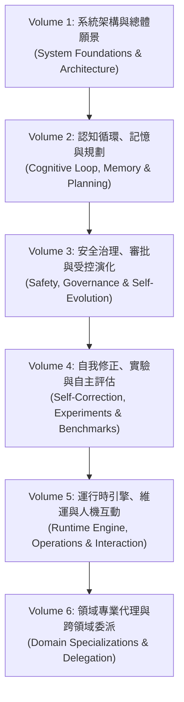

# AIA Specification System: Master Architecture & Volume Catalog

> [!IMPORTANT]
> **AIA 規格體系架構重整與編號封頂公告 (Specification Numbering Freeze & Consolidation)**
>
> 經架構審查與共識裁定，AIA 規格體系自 **AIA-22** 起正式**永久封頂**，不再無限增編新的單項規範（如已廢止之 AIA-23 草案）。
> 過去分散於 AIA-00 至 AIA-22 的 23 份規格已全面收攏重整為 **6 大核心卷軸（Volumes 1 ～ 6）**。
> 任何系統新功能與演進，一律直接在對應的 Volume 核心模組中持續維護，杜絕補丁式規格膨脹與概念漂移。

---

## 1. 六大核心卷軸總覽 (The Six Consolidated Volumes)

| 卷軸編號 | 卷軸名稱 | 核心職責 | 涵蓋整合之既有規範 | 主要代碼映射 |
|---|---|---|---|---|
| **[Volume 1](file:///home/wade/src/github/aia/docs/specifications/volume-1-system-foundations.md)** | **系統架構與總體願景** | 定義 AIA 本質、本地常駐原則、專案生命週期、六層架構與核心哲學 | AIA-00, AIA-01, AIA-02, AIA-18 | `internal/app/`, `internal/domain/project/` |
| **[Volume 2](file:///home/wade/src/github/aia/docs/specifications/volume-2-cognitive-loop-and-planning.md)** | **認知循環、記憶與規劃** | 11 步自治循環、四種記憶與五層權威體系（L1~L5）、知識溯源、開放問題建模與版本化 Plan | AIA-08, AIA-09, AIA-10, AIA-16, AIA-22, memory.md | `internal/autonomy/`, `internal/continuity/`, `internal/service/problem/`, `internal/service/knowledge/` |
| **[Volume 3](file:///home/wade/src/github/aia/docs/specifications/volume-3-safety-and-governance.md)** | **安全治理、審批與受控演化** | Level A/B/C 三級隔離、反自我審批、沙盒驗證管線 (V1~V6)、Token 預算硬閘門、緊急停機 | AIA-14, AIA-17 | `internal/policy/`, `internal/service/governance/`, `internal/service/approval/`, `internal/service/selfmod/` |
| **[Volume 4](file:///home/wade/src/github/aia/docs/specifications/volume-4-self-correction-and-experiments.md)** | **自我修正、實驗與自主評估** | 結果落差量測、可證偽 RCA、3-Tier 配置、L0~L3 成熟度、G1 凍結對照實驗、M0~M10 可計算指標 | AIA-11, AIA-13, AIA-15 | `internal/autonomy/learning/`, `internal/autonomy/evaluation/`, `internal/experiment/` |
| **[Volume 5](file:///home/wade/src/github/aia/docs/specifications/volume-5-runtime-and-interaction.md)** | **運行時引擎、維運與人機互動** | Go 1.23 本機 Daemon、併發 Worker、SQLite WAL 持久化、台灣時區自動喚醒、16 分頁 Web Console、通用 Brief 與阻斷式 Clarification | AIA-03, AIA-06, AIA-07, AIA-19, AIA-21 | `internal/worker/`, `internal/storage/sqlite/`, `internal/web/`, `internal/service/brief/`, `internal/service/clarification/` |
| **[Volume 6](file:///home/wade/src/github/aia/docs/specifications/volume-6-domain-specializations.md)** | **領域專業代理與跨領域委派** | 投資（10 萬虛擬資金/無前視回放）、代碼（沙盒自修/L2 測試）、寫作（540 章小說規範稽核）、跨領域契約委派 | AIA-05, AIA-12, AIA-20 | `internal/service/investment/`, `internal/domain/coding/`, `internal/service/writing/`, `internal/service/delegation/` |

---

## 2. 既有 AIA-00 ～ AIA-22 歷史規格對齊矩陣 (Cross-Reference Matrix)

為確保現有代碼註釋（1,000+ 處鏈接）、測試案例與外部引用的相容性，既有單號規範檔案均已保留並標註導向對應 Volume 的索引標籤：

| 歷史編號 | 原規範名稱 | 對應收攏卷軸 | 卷軸內主要章節定位 |
|---|---|---|---|
| **AIA-00** | Overall Architecture and Evolution Roadmap | **Volume 1** | §1 系統演進藍圖與雙軌模型 |
| **AIA-01** | Product Requirements Specification | **Volume 1** | §2 核心產品定位與非功能性需求 |
| **AIA-02** | System Architecture Specification | **Volume 1** | §3 六層系統架構與職責矩陣 |
| **AIA-03** | Go Runtime Implementation Specification | **Volume 5** | §1 Go Runtime 核心、併發與 Worker |
| **AIA-04** | Test Plan and Release Specification | **Volume 4** | §4 驗證門禁與發布測試規範 |
| **AIA-05** | Investment Agent Specification | **Volume 6** | §1 投資 Pilot 領域規範與虛擬決策 |
| **AIA-06** | Embedded Web UI & Agent Interface | **Volume 5** | §3 16-Tab Web Console 與 REST API |
| **AIA-07** | User Manual & Operational Usage | **Volume 5** | §4 CLI 運維操作與使用者手冊 |
| **AIA-08** | Autonomy Core Specification | **Volume 2** | §1 11 步自治循環與協同流程 |
| **AIA-09** | Initiative & Goal Evolution Specification | **Volume 2** | §2 主動性發現與目標治理演化 |
| **AIA-10** | Continuity & Long-Term Project Management | **Volume 2** | §3 跨會話時間連續性與脈絡還原 |
| **AIA-11** | Self-Correction & Learning Specification | **Volume 4** | §1 可驗證自我修正、RCA 與 3-Tier |
| **AIA-12** | Cross-Domain Collaboration & Agent Delegation | **Volume 6** | §4 跨領域契約委派與任務具體化 |
| **AIA-13** | Autonomy Evaluation & Benchmarking | **Volume 4** | §3 M0～M10 可計算自主能力指標 |
| **AIA-14** | Self-Modification & Safe Code Evolution | **Volume 3** | §2 Level A/B/C 三級隔離與自修管線 |
| **AIA-15** | Autonomous Experiment Lifecycle | **Volume 4** | §2 11 狀態長週期實驗與 G1 對照組 |
| **AIA-16** | Data Provenance & Knowledge Integrity | **Volume 2** | §4 5D 來源信賴、證據鏈與主張版本 |
| **AIA-17** | Operational Governance & Human Oversight | **Volume 3** | §1 運作治理、Token 硬閘門與緊急停機 |
| **AIA-18** | Autonomy Core Integration & Reference Arch | **Volume 1** | §4 跨模組端到端整合參考架構 |
| **AIA-19** | Deployment, Operations & Observability | **Volume 5** | §2 systemd 維運、SQLite 備份與分散式追蹤 |
| **AIA-20** | Book Manifest & Novel Project | **Volume 6** | §3 長篇小說專案結構與約束檢驗 |
| **AIA-21** | Project Brief & Clarification Management | **Volume 5** | §5 通用專案綱要與阻斷式人機互動 |
| **AIA-22** | Complex Problem Analysis and Planning | **Volume 2** | §5 開放問題形式化建模、DAG 計畫與重評 |
| ~~AIA-23~~ | *(Agent Operating Modes & Scheduling)* | **Volume 5** | *(不立獨立編號，直接納入 Volume 5 §1 排程與工作模式)* |
